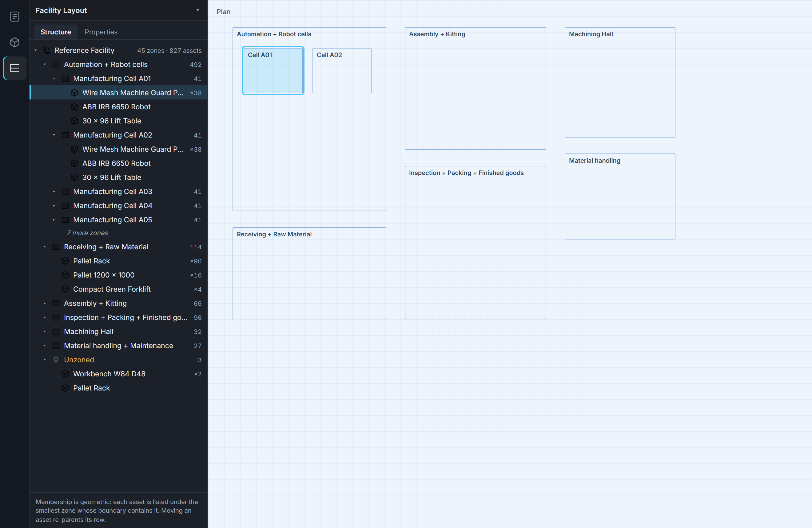

# Facility Layout Structure Tree Plan

Date: 2026-09-22 (revision 5 - fourth review pass)

Status: implemented as of 2026-09-23. FT0-FT4 complete; FT5 complete in the
browser, with the Electron half recorded as an open gap. Section 7a carries
what landed, what the app verification found, and what blocks promotion.

Revision 2 answered a first independent review: five contracts tightened, and
three claims from revision 1 corrected in place - the represented layout
(section 2a), grouped-row selection (section 3a), the left-panel lifecycle
(section 2), notification frequency and what the benchmark proves (section 5),
and the containment rule (section 3.2a).

Revision 3 answers a second pass, which found that four of those amendments had
not been carried through the rest of the document. Policy stated in one section
was contradicted by a phase description in another. Fixed: the architecture
diagram and refresh path now cover previews, which do not notify the session
(section 6); the row-kind table and FT3 now agree on one selection behaviour
(sections 3a, FT3); FT2 no longer repeats the auto-collapse mistake and carries
the full entry/exit matrix; and the benchmark is split across the phases that
can measure each part (section 5, FT1, FT2, FT5). Containment rule 3 now states
smallest area first, then `zoneId`.

Revision 4 answers a third pass, which found a bug introduced by revision 3:
expansion state was scoped by a key containing `revision`, so an ordinary edit
would have collapsed every open branch. Rebuilding and remembering are separate
questions and now use separate keys (section 6), FT4 no longer carries the older
wording, and an acceptance sequence covers expansion surviving an edit while
staying independent across a preview. Group toggling gained two requirements:
it preserves unrelated selections and lands as one `selectMany`.

Revision 5 answers a fourth pass, which closed the last identity gap: a group
row scoped only by asset identity collides across zones. Row IDs are now scoped
by parent (section 6), grouping is stated as per-zone (section 3a), and FT2
gains an isolation test. Measurement backing it: 18 of the reference layout's 37
distinct assets occur in more than one zone, `asset-operator` in seventeen. The
architecture is unchanged throughout, and this revision is the baseline the
reviewer accepted for implementation.

Working name: FT0-FT5

## 1. Objective

Give the Facility Layout workflow a docked structure tree, in the manner of a
SOLIDWORKS FeatureManager, so the layout can be read and selected as a
hierarchy rather than only as geometry on a canvas.

```text
the represented layout          draft, or a preview candidate (section 2a)
  -> zones and placements it already contains
  -> membership derived geometrically, by the rule in section 3.2a
  -> the tree renders that derivation, lazily, per branch
  -> a row selects through the existing session API, by row kind (section 3a)
  -> a change of represented revision rebuilds the derivation (section 5)
```

The tree adds **no new authority over the layout**. It does not decide where
anything belongs; it reports where geometry already places it. Every row it
shows is a zone or placement that exists in the layout, and every selection it
makes goes through `session.select` / `session.selectMany` exactly as a canvas
click does.

This work is orthogonal to the generation gates in
`sage-research-layout-implementation-report.md`. It requires only a layout; it
does not require generation, routing, or motion.

## 1a. Mockup



`docs/mockups/facility-structure-tree-left-rail.png`

Every label and count in that image is derived from
`fl-reference-manual-20260812` by running the real containment rule, not drawn
by hand. `Automation + Robot cells` genuinely holds 492 assets across 12 child
zones, and Cell A01 genuinely holds 38 guard panels, one robot and one lift
table. The one invented element is the `Unzoned` branch: the reference layout
has no unzoned placements, so it is shown as it would appear while authoring
from empty, which is the case section 3.3 describes.

The image demonstrates, in order: the four-level hierarchy of section 3.1;
grouping by asset rather than one row per placement; lazy expansion, shown as
`7 more zones`; both zone shapes, since `Receiving + Raw Material` has no child
zones and lists its assets directly; the unzoned branch in amber, not red,
because it is a normal authoring state and not an error; two-way selection, with
Cell A01 lit in both the tree and the plan; and the geometric-membership rule
stated in the footer per section 4.2.

A right-docked variant was mocked first and rejected for the reasons in section
2; it is retained as `mockups/facility-structure-tree-right-rejected.png` so the
reviewer can weigh the choice rather than take it on trust.

Both images regenerate from `tools/mockups/facility_structure_tree_model.py`,
which derives the hierarchy from the layout, and
`tools/mockups/facility_structure_tree_mockup.py`, which renders it. Re-running
them against a changed layout is how this mockup stays honest.

## 2. What Already Exists

Verified in the working tree on 2026-09-22.

**A left slot the tree can occupy - but its lifecycle is narrower than it
looks.** `.left-panel` is a 240px column with an existing toggle. An earlier
draft of this plan said the app "deliberately collapses it on entering this
workflow". That overstates it. The auto-collapse runs only inside native
initialisation with a `facilityLayoutId` URL parameter:

```js
if (window.InspectorProNativeApplication
        && new URLSearchParams(location.search).has('facilityLayoutId')) {
    ...
    window._toggleLeftPanel();
    _desktopAutoCollapsedPartPanel = true;
}
```

Ordinary entry to Facility Layout - switching workflows in the app, or a browser
session without that parameter - does not collapse anything. And
`_toggleLeftPanel` changes **visibility only**; nothing today owns *which*
content that slot holds.

**Consequence for this plan.** Visibility and content are two separate pieces of
state and must be modelled separately:

- `leftPanelVisible` - already exists, toggled by the rail and by Ctrl+B.
- `leftPanelContent` - new: `drawing` or `structure`.

FT2 must define behaviour for every entry path, not just the native one: native
entry with the URL parameter, ordinary in-app workflow switching, switching to a
*different* workflow inside Workflows, Ctrl+B, and browser entry. Leaving
Facility Layout must restore the user's prior Drawing state, including the case
where they left while Structure was showing and the case where they had
collapsed the panel themselves.

`static/index.html` is therefore an affected file - the activity bar, the
toggle, and `_desktopAutoCollapsedPartPanel` all live there - and section 11
accounts for it.

**The right edge is Sage's.** The agent panel is a flex sibling of the viewport
on the right. Putting a structure tree there would make the tree and the
assistant compete for one edge, and would break the convention every CAD tool
shares - SOLIDWORKS, Fusion and Inventor all place the feature tree on the left.
The reference screenshot for this request has it on the left too.

**A two-column shell, for the properties rail.** `.ip-flw-shell` is
`grid-template-columns: minmax(360px, 1fr) minmax(210px, 270px)`, with
`.ip-flw-properties` in the second column; the integrated workflow collapses it
to one and floats the properties pane at `top: 44px; right: 14px`. That rail
stays as it is. The tree is a left-side peer of it, not a second tenant.

**A properties pane with collapse states.** `.ip-flw-properties` supports
`[hidden]` and `[data-collapsed="true"]` - the pattern the tree pane should
reuse for its own collapse.

**An activity rail that already extends and retracts a left pane.** The tree's
entry point is a third icon in `#activityBar`, below Drawing and 3D Model. The
pattern is fixed by the two that exist:

```html
<div class="activity-bar-icon" data-panel="structure" title="Structure">
  <span class="shell-rail-icon" aria-hidden="true">
    
    
  </span>
  <span class="activity-tooltip">Structure</span>
</div>
```

and the routing is a `switch (panel)` where `explorer` is already a true
extend/retract toggle:

```js
case 'explorer':
    if (window._toggleLeftPanel) window._toggleLeftPanel();
    break;
```

`syncActiveState()` then reflects pane visibility back onto the icon's `active`
class, driven by a `MutationObserver` on `.left-panel`. A `structure` case joins
that switch and that sync. Nothing new is invented for show/hide.

Two icon assets must be authored, dark and light, to match the existing set
(`drawing.svg`, `model_3d.svg`, ...). That is the only new artwork this plan
requires.

**A single state choke point - carrying more than layout changes.**
`this.session.subscribe(this._handleSessionState)` receives every layout change:
zone creation, placement, deletion, undo, and Sage-driven edits. Nothing needs
per-command wiring.

It also receives a great deal that is **not** a layout change. `notify()` is
called by `setCameraState`, by `select`, and by `updateGhostPlacement`, the last
of which fires continuously while a ghost is dragged. Placement drags do preview
locally through `_setPlacementMovePreview` and only commit via
`session.movePlacements` on release - but that is not true of the subscription
as a whole, and revision 1 of this plan wrongly generalised it to "fires once
per completed operation". Section 5 states what the tree actually keys on.

**A selection API.** `Workspace.prototype.handleViewSelection` calls
`this.session.select(id, {additive, toggle})`, and marquee selection calls
`this.session.selectMany(ids, {additive})`. A tree row needs no new path.

**A tree precedent.** `process_map_editor.js` implements
`renderStructureTree` and `_renderStructureOccurrence`: recursive rows, carets,
selection, drag. The pattern transfers. The code does not - it is bound to
`ProcessMapEditor` and its occurrence model, and should be read, not imported.

**A panel-building precedent.** `Workspace.prototype._buildLayerPanel` shows
the established shape for a titled panel with rows inside this workspace.

## 2a. Which Layout The Tree Represents

The first draft said the tree derives from `state.layout`. That is insufficient,
because the viewport does not always show `state.layout`.
`Workspace.prototype._syncController` renders a preview descriptor built from
`activeLayoutAlternative(this.state)` or from `this.constructionPreview` when one
is active. A generation, construction or alternative candidate can therefore be
on screen while `state.layout` still holds the untouched draft - so a naive tree
would show an empty structure beside a populated preview.

Selection makes the same distinction binding. `session.select` resolves against
the **draft** layout:

```js
const exists = selectedIdsInLayout(draftLayout, [value]).length > 0;
if (!exists) return getState();          // silently ignored
```

Passing a candidate-only placement ID into ordinary selection does nothing, with
no error. The tree must never do that.

**Contract.** The tree represents exactly one layout at a time, and says which:

- With **no preview active**, it represents the editable draft. Rows select
  normally.
- With a **preview active**, it represents the previewed candidate, is marked as
  such in the pane header, and is **read-only**: rows do not call
  `session.select`. Individual placement rows may still be inspected, but
  selection is disabled for the duration rather than silently failing.
- The represented layout's identity and revision are the invalidation key from
  section 5.

FT2 must exercise preview opening, replacement by a second preview, dismissal,
Apply, and Undo, and show the tree following each transition.

## 3. The Derivation, And Why It Is The Whole Problem

**Zone membership is not stored.** Measured against the reference layout:

| Record | Fields | Membership link |
| --- | --- | --- |
| placement | assetDefinitionRevision, assetId, metadata, placementId, positionMode, snapRelationship, transform | none |
| zone | anchors, boundary, evidence, extensions, floorElevation, label, zoneId, zoneType | none |

There is no `zoneId` on a placement and no placement list on a zone. The
relationship exists only as geometry, and the tree must compute it the same way
`movement_inventory.py` already does: point in polygon, smallest containing
zone wins.

Three consequences follow, and they are the actual design content of this work.

### 3.1 Zones nest

Reference layout: 45 zones at three depths - 6 top level, 27 at depth 1, 12 at
depth 2. An asset inside `Inpection Station Q01` is also inside
`Inspection + Packing + Finished goods`. Smallest-containing is the rule; it
must be stated in the UI, not implied, because both answers are true.

The tree is therefore four levels, not the three a flat sketch suggests:

```text
Facility Layout
  Machining Hall                     (6 of these)
    Manufacturing Cell A01           (27 at this depth)
      Inpection Station Q01          (12 at this depth)
        placements
```

### 3.2 Membership is positional, so it changes silently

Dragging a bench from Assembly into Machining reparents its row with no
confirmation. That is correct for a derived hierarchy and will still feel like
the tree moved something by itself. The tree must not imply it authored the
move.

### 3.2a The containment rule, stated exactly

FT1 cannot be written against "point in polygon, smallest wins". The existing
resolver in `movement_inventory.py` already makes choices this plan must either
adopt or deliberately diverge from:

```python
containing = [zone for zone in zones if zone["polygon"].covers(point)]
zone = min(containing, key=lambda item: item["polygon"].area)
```

`covers` **includes the boundary**, and `min` resolves ties **by input order**,
which is not stable ordering - it depends on the order zones arrive in.

The rule for this plan:

1. **Zone parenting is whole-polygon.** Zone B is a child of zone A when A
   covers B's entire polygon and A's area is strictly greater. Not centroid,
   not overlap.
2. **Placement containment is by placement origin**, and the boundary is
   **inclusive**, matching `covers`. A placement exactly on a shared edge
   belongs to the zone, not to Unzoned.
3. **Resolution is smallest area first, then `zoneId` ascending.** Among all
   containing zones, the smallest area wins; only where areas are equal does
   `zoneId` decide. Both steps are required: area alone is not deterministic
   when two zones tie, and `zoneId` alone would ignore nesting. Reordering the
   `zones` array must not change any row.
4. **Overlapping, non-nesting zones** (neither covers the other) are both valid
   parents of a point in the overlap. Rule 3 applies unchanged - smallest area,
   then `zoneId` - and the placement appears once, under that one zone. It is
   never listed twice.
5. **Invalid geometry does not fail the tree.** A zone whose polygon cannot be
   evaluated reports the failure on its own row and contributes no containment;
   its would-be contents fall to the next containing parent, or to Unzoned.

FT1 tests must include a concave polygon, where a bounding-box prefilter accepts
a point the polygon rejects, and a reordered `zones` array asserting identical
output.

### 3.3 An asset can belong to no zone

No constraint requires a placement to sit inside a zone, and the empty fixture
starts at zero of both. Building from empty, a user will place something before
its zone exists. Those placements need an explicit home in the tree or they
disappear from a view that claims to show the whole layout.

## 3a. Row Kinds, And What A Grouped Row Selects

`Wire Mesh Guard Panel x38` is not an entity. It is a synthetic row standing for
38 placements, and the first draft left its selection behaviour undefined while
FT3 said "row clicks call `session.select`". The mockup generator has the same
defect: `tools/mockups/facility_structure_tree_model.py` groups with
`Counter(z["assets"])` over asset IDs and **discards placement IDs entirely**,
so it cannot answer what a group row would select. That is acceptable in a
mockup and not in the implementation.

The tree has three row kinds, and they behave differently:

Expansion and selection are separate gestures: **the caret expands, the label
selects.** A zone row is not inert - clicking its label selects the zone, the
same as clicking the zone on the canvas.

| Row kind | Represents | Label click | Ctrl / Meta click |
| --- | --- | --- | --- |
| zone | one zone | `select(zoneId)` | toggles that zone |
| group | N placements of one asset identity | `selectMany(memberIds)`, replacing | toggles the whole group as a unit |
| placement | one placement | `select(id)` | toggles that placement |

Ctrl-click **toggles**; it is not merely additive. That matches the canvas,
where `handleViewSelection` passes `{ additive, toggle }` with both set from the
same modifier, and `session.select` takes the `toggle` branch when it is present.
A tree that only added would diverge from the canvas on the second click.

A group toggles as a unit: if any member is unselected, the gesture selects all
of them; if all are selected, it deselects all. Partial state is displayed, not
produced, by group gestures - it arises when members are selected individually
or from the canvas.

Two requirements on that gesture:

- **Entities outside the group are untouched.** Ctrl/Meta-toggling a group must
  leave every other selected entity selected. It computes the next selection
  from the current one, and never replaces the selection wholesale.
- **It lands as a single `selectMany`.** One call carrying the resulting set,
  not N calls per member: each would `notify()`, producing N broadcasts and N
  highlight passes for one gesture.

Requirements:

- **Groups retain their member placement IDs.** A group row carries the exact
  list it stands for; it is never re-resolved from a display name at click time.
- **Group by asset identity and revision**, `assetId` + `assetDefinitionRevision`,
  not by display name. Two revisions of one asset are two groups even where the
  catalog name is identical, because they are different entities.
- **Grouping is scoped to one zone.** A group never spans zones: the same asset
  in two cells is two groups, addressed by the row ID in section 6. This is what
  the counts in the mockup already show, and 18 of the reference layout's 37
  assets occur in more than one zone.
- **Partial selection is shown.** When some but not all of a group's members are
  selected, the row renders a distinct partial state rather than reading as
  fully selected or fully unselected.
- **Individual occurrences remain reachable.** A group expands to its placement
  rows; grouping is a default, not a ceiling.

## 4. Product Boundary

### 4.1 The tree may claim

- These zones and placements exist in this layout at this revision.
- This placement's position currently falls inside this zone's boundary.
- This row corresponds to that entity; selecting it selects that entity.

### 4.2 The tree must never claim

- That membership is authored, approved, or process-meaningful. It is geometric
  containment and nothing else.
- That a zone's contents constitute a work cell, a station, a capacity, or an
  ownership boundary.
- That the tree is a source of truth. The layout is; the tree is a projection.
- That an empty zone is unused, or that an unzoned asset is misplaced.

### 4.3 Required refusals

- With no layout loaded, the pane shows an explicit empty state, not a blank
  panel.
- Where a placement falls in no zone, it appears under an explicit unzoned
  branch, never omitted and never guessed into the nearest zone.
- Where geometry is unreadable for a zone, that zone reports the failure in
  place rather than rendering as empty.

## 5. Performance

Measured on the reference layout: 827 placements against 45 zones, ray casting,
200 runs.

| Approach | Full rebuild |
| --- | --- |
| naive | 0.51 ms |
| bounding-box prefilter | **0.19 ms** |

**Correction (review revision 2).** An earlier draft of this plan claimed the
subscription "fires once per committed operation rather than per pointer move".
That is wrong. `notify()` is called by `setCameraState`, by `select`, and by
`updateGhostPlacement` - so panning the camera, changing selection, and dragging
a ghost placement all reach subscribers, the last of them continuously. Any
design that rebuilt on every notification would rebuild the tree while the
camera moves.

The 0.19 ms figure also measures **derivation only**, in Node, with no DOM. It
does not establish the browser cost of building rows, and must not be used to
justify rebuilding DOM on every notification.

The plan therefore specifies:

- **Recompute the hierarchy when the represented geometry changes**, keyed on
  the identity and revision of the layout being represented (section 2a), not on
  every notification. This is revision-based invalidation. It is *not*
  incremental geometry diffing, which remains forbidden: when the revision
  changes, the whole hierarchy is rebuilt.
- **Update selection highlighting on its own path**, without rebuilding rows.
  Selection changes arrive far more often than geometry ones.
- **Ignore camera notifications entirely** for tree purposes.

The benchmark is reproducible JavaScript reporting **hierarchy, grouping and
rendering separately**, and it is split across the phases that can actually
measure each part: hierarchy and grouping in FT1, which has no DOM; DOM
rendering in FT2, where the renderer exists; integrated Electron and browser
responsiveness in FT5. No phase is asked to measure something it has not built.

Rendering, not derivation, is the cost that matters. Of 827 placements, 456 are
the same wire-mesh guard panel, and the busiest leaves hold 114 and 41. A raw
expand produces a wall of identical rows.

## 6. Architecture

```text
representedLayout()            one resolver, shared with the viewport
  |  { layout, kind: 'draft' | 'candidate', proposalId, revision }
  |
  +-> deriveStructure(layout)        pure, no DOM, unit testable
        |
        +-> { roots, byZone, unzoned, counts }
        |
      renderTree(model, viewKey)     lazy: children built on expand
        |
      row click -> session.select / selectMany   (draft only; see 2a)

refresh triggers
  session broadcast  -> _handleSessionState  -> re-resolve, rebuild if revision moved
  preview open/replace/close -> _syncController -> re-resolve, rebuild
```

**The tree cannot rely on the session broadcast alone.** Generation previews
refresh through the workspace directly:

```js
function refresh() {
    if (workspace.destroyed) return;
    workspace._renderDesignPanel();
    workspace._syncController();     // no session notify
}
```

`close()` calls the same `refresh()`. So opening, replacing and dismissing a
preview all move what the viewport shows without any subscriber hearing about
it. The tree must therefore be refreshed from the same place the viewport is -
`_syncController` - and not only from `_handleSessionState`.

**One resolver, two consumers.** `representedLayout()` returns the layout the
viewport is currently showing together with its kind, proposal identity and
revision. `_syncController` already computes this to build its preview
descriptor; the tree consumes the same result rather than inferring it
separately. Two independent answers to "what is on screen" would drift.

**Two keys, not one.** Revision 3 of this plan scoped expansion by
`{ kind, proposalId, layoutId, revision }`. That is wrong: an ordinary edit
changes the revision, so every branch the user had opened would collapse each
time they moved a piece of equipment. Rebuilding and remembering are different
questions and need different keys.

| Key | Fields | Answers |
| --- | --- | --- |
| derivation invalidation | `{ kind, proposalId, layoutId, revision }` | has the represented geometry changed, so must the hierarchy be rebuilt |
| expansion namespace | `{ kind, proposalId, layoutId }` | which view's expanded set is this, so it survives edits within that view |

`revision` belongs in the first and must not appear in the second. `kind` and
`proposalId` must appear in both, because a candidate may legitimately carry the
same `layoutId` **and the same zone IDs** as the draft it was derived from;
without them, opening a preview would inherit the draft's expanded set and
dismissing it would hand back the candidate's.

Inside a namespace, expansion is recorded against **stable row IDs**, never row
indices, which move as the layout changes. A row ID is scoped by where the row
sits, not only by what it holds:

| Row kind | Row ID |
| --- | --- |
| zone | `zoneId` |
| group | parent scope (`zoneId`, or a distinct `unzoned` scope) + `assetId` + `assetDefinitionRevision` |
| placement | `placementId` |

**The parent scope is required, not decorative.** The same asset appears in many
zones, so asset identity alone collides. Measured on the reference layout:
**18 of its 37 distinct assets appear in more than one zone**, and
`asset-operator` appears in **17**. Without the parent scope, expanding the
guard-panel group in one cell would expand the identical group in every other
cell, and `asset-operator` would share one key across seventeen rows.

Unzoned needs its own scope rather than a null zone ID, so its groups are
addressable and cannot collide with a zone that happens to be missing an ID.

`deriveStructure` takes a layout and returns a plain object. It touches no DOM,
holds no state, and is the only place containment is decided. It is testable
without a browser, which is what makes the rule in 3.1 reviewable.

## 7. Implementation Phases

### FT0 - Baseline And Fixtures

Record the current state before changing anything: reference layout counts,
nesting depths, the 0.19 ms measurement, and screenshots of the workflow with
no pane. Add an empty layout and a single-zone layout to the fixtures so the
empty and shallow cases are covered from the first commit.

Exit: baseline committed, no production file touched.

### FT1 - Derived Hierarchy Module

`deriveStructure(layout)` as a pure function, with the bounding-box prefilter.
Smallest-containing resolution, explicit unzoned collection, per-zone counts,
stable ordering that does not depend on object key order.

Exit: unit tests for every rule in section 3.2a - nested zones, an asset in no
zone, an asset exactly on a boundary, overlapping equal-area zones, a concave
polygon that defeats the bounding-box prefilter, a reordered `zones` array
producing identical output, invalid zone geometry, an empty layout, and a layout
with zones but no placements. Plus the **hierarchy and grouping** halves of the
benchmark required by section 5; rendering cost belongs to FT2, which is where
the renderer arrives, and integrated responsiveness to FT5. No DOM, no workspace
changes.

### FT2 - Pane Shell, Rail Icon, And Read-Only Tree

Dock the pane in the left slot described in section 2 and add the `structure`
rail icon beneath 3D Model, with its two artwork variants, its `switch` case and
its `syncActiveState` branch. Extend and retract reuse `_toggleLeftPanel`; no
second show/hide mechanism is introduced.

The Drawing panel and the structure tree share that one slot and are mutually
exclusive, as the activity rail implies: selecting one replaces the other rather
than splitting the width.

Implement the two-field contract from section 2 - `leftPanelVisible` and
`leftPanelContent` - rather than assuming an auto-collapse. The existing
collapse fires only under native initialisation with a `facilityLayoutId`
parameter, so it cannot be relied on as the entry behaviour.

Every path must be defined, not just the native one:

| Path | Required behaviour |
| --- | --- |
| native entry with `facilityLayoutId` | content becomes `structure`; the existing collapse must not fight it |
| in-app switch into Facility Layout | content becomes `structure`; visibility unchanged from the user's last choice |
| switch to another workflow **inside Workflows** | content returns to `drawing`; Structure does not persist into a workflow that has no layout |
| leaving the Workflows tab | prior Drawing state restored, including a panel the user had collapsed themselves |
| Ctrl+B | toggles visibility only; never changes content |
| browser entry, no URL parameter | no collapse occurs; content still resolves correctly |

Lazy expansion: a branch computes and renders its children the first time it
opens. Grouping of identical assets within a zone (`Wire Mesh Guard Panel x38`)
rather than one row each. Empty state and unzoned branch per section 4.3.

Exit: the rail icon extends and retracts the pane and reflects its state; the
tree renders the reference layout, expands and collapses, and shows the unzoned
branch on a fixture that has one. **Every row in the path table above passes**,
including switching to another workflow without leaving the Workflows tab. The
**rendering** half of the section 5 benchmark is measured here, against the
827-placement reference layout with a branch expanded. Preview opening,
replacement, dismissal, Apply and Undo each move the tree, per section 2a.

**Group rows are isolated per zone.** Expanding the guard-panel group in
`Manufacturing Cell A01` must leave the identical group in `Cell A02` collapsed,
and the reference layout gives a harder case in `asset-operator`, which occurs in
seventeen zones. No selection yet.

### FT3 - Selection Binding

Implement the row-kind contract in section 3a exactly: caret expands, label
selects, Ctrl/Meta **toggles** rather than merely adding, and a group row acts
on its retained member IDs as a unit. Selection arriving from the canvas
highlights the corresponding row, reveals its ancestors, and drives the
partial state on any group whose members are only partly selected. One selection
model, two views.

Selection is disabled entirely while a preview is represented, per section 2a.

Exit: canvas-to-tree and tree-to-canvas selection agree in both directions for
all three row kinds, including multi-select and including a second Ctrl-click
deselecting what the first selected; partial group state appears when members
are selected from the canvas; and no row click reaches `session.select` while a
preview is active. Verified against the reference layout.

### FT4 - Dynamic Behaviour

Invalidate on the represented layout's revision, per section 5 - not on every
`_handleSessionState` call, since camera, selection and ghost-drag notifications
all arrive there. Selection highlighting updates on its own path without
rebuilding rows.

Preserve expansion state across rebuilds using the **expansion namespace** from
section 6 - `{ kind, proposalId, layoutId }`, with stable row IDs inside it.
Deliberately **not** the invalidation key: including `revision` there would
collapse every open branch on each edit, which is the failure this phase exists
to avoid.

Verify the cases from section 3. **Deleting a nested zone moves its placements
to the next containing parent, not to Unzoned** - an earlier draft of this plan
said otherwise, and it was wrong: a placement inside `Cell A01` inside
`Automation + Robot cells` is still inside `Automation` after `Cell A01` is
deleted. Only a placement with no remaining containing zone becomes Unzoned.

Exit: build-from-empty exercised end to end - place assets, draw zones around
them, move one across a boundary, delete a nested zone and confirm reparenting
to the surviving parent, delete a top-level zone and confirm the fall to
Unzoned, undo each step. Confirm a camera pan and a selection change rebuild
nothing.

And this sequence, which is what the two keys exist for:

1. Expand a draft branch.
2. Move a piece of equipment. **The branch stays expanded** - the revision moved,
   so the hierarchy rebuilt, but the expansion namespace did not change.
3. Open a candidate that contains the same zone IDs. **Its expansion is
   independent** - it starts from its own namespace, not the draft's.
4. Dismiss the candidate. **The draft's original expansion returns.**

### FT5 - Evaluation And Promotion

Screenshots at the reference layout and at an empty layout. Confirm the pane
can be collapsed and that collapsing it returns the full viewport width.

Run in **both the Electron application and the browser**, and in each with
**Sage open and the research pane open**, since those compete for the same
horizontal budget and the browser path never triggers the native auto-collapse
described in section 2.

Accessibility pass: the tree is a `tree` role with `treeitem` rows, keyboard
navigable, and the pane is reachable without a pointer. **Keyboard focus
survives selection and rebuilds** - a rebuild triggered by a layout change must
not drop focus out of the tree or reset it to the first row.

Exit: promotion decision recorded with evidence, or the gap that blocks it.

## 7a. Implementation Status

Updated 2026-09-23, after FT5.

| Phase | State | Lands in |
| --- | --- | --- |
| FT0 | done | fixtures, baseline counts |
| FT1 | done | `static/facility_layout_structure.js` |
| FT2 | done | `static/facility_layout_structure_tree.js`, pane, rail icon |
| FT3 | done | selection binding both ways |
| FT4 | done | invalidation, expansion, reparenting, build-from-empty |
| FT5 | done in the browser; Electron not run (see the gap below) | evidence in `docs/evidence/facility-layout-structure-tree/` |

Tests: 27 derivation, 34 renderer, 88 workspace, 41 app. The app checks live in
`tests/verify_facility_layout_structure_tree_app.py`, which drives a real
browser against a local server and is the only place the workspace wiring is
exercised.

### What FT3 added

- `render()` takes a `selection` array. The tree stores no selection of its
  own, so the session stays the single source of truth in both directions.
- `onSelect(kind, payload, event)` where `payload` is `{rowId, ids, additive}`.
  `ids` carries every entity the row stands for, so a group acts as a unit.
  Enter and Space select; the caret and the arrow keys expand.
- `toggleSelection(currentIds, memberIds)` in the derivation module: pure set
  arithmetic for the group toggle, testable without a DOM.
- Ancestors are revealed when the **selection changes**, not on every draw, so
  revealing never fights a user who has collapsed a branch.

### What FT4 added

- Rebuild and redraw counters on the host, so "a camera pan rebuilds nothing"
  is measured rather than asserted. Five camera moves produce notifications and
  zero rebuilds and zero redraws; a selection change redraws without
  rebuilding; an edit rebuilds.
- Derivation tests for the reparenting rule this plan calls out, because an
  earlier draft had it backwards: deleting a nested zone sends its contents to
  the next containing zone, and only a placement with no containing zone left
  becomes Unzoned. Deleting a middle zone also reparents its **child zones** to
  the surviving ancestor, not just its assets.
- Renderer tests for rows that disappear and return: a deleted branch takes its
  rows with it and leaves its siblings open, and undoing the deletion brings it
  back still expanded, because expansion is keyed by row ID inside a namespace
  that revision does not touch.

### Three defects this work found in FT2's wiring

All three would have made the pane silently wrong in the app while every unit
test passed, because those tests feed the renderer a model directly and never
touch the workspace. They are the argument for the app-level script existing.

1. `_structureRepresentedLayout` read `state.layout` from `workspace.getState()`,
   which nests the session under `.session`. The tree would have derived from
   `undefined`. Hence `Workspace.structureSource()`, a clone-free read of just
   the four fields the tree needs.
2. The session carries no top-level `layoutId` - it is on the layout. The
   accessor returned `''`, which would have let two different layouts share one
   invalidation key *and* one expansion namespace.
3. `generationPlanningView.activeLayout()` returns the candidate **layout
   document itself**, not a `{layout, ...}` wrapper, and carries no candidate
   identity. The preview branch tested for `.layout` and so could never fire:
   a candidate would have been drawn as if it were the draft, editable. Fixed,
   with a small additive `activePreviewRef()` on the generation view supplying
   the candidate identity the two keys need.

### Verified in the app

Against `fl-reference-manual-20260812` (45 zones, 827 placements) and the blank
`fl-main`, with nothing ever saved - the stored base revision is asserted
unmoved at the end of the run.

**Build from empty.** Place equipment on an empty layout (it lands in Unzoned),
draw a zone around it, nest a second zone, move a placement across a boundary,
delete the nested zone and watch its contents reparent to the surviving parent
rather than fall to Unzoned, undo, remove the last zone and watch everything
fall to Unzoned, undo again.

**The four-step sequence.** Expand a draft branch; move equipment and the branch
stays expanded; open a candidate sharing the draft's zone IDs and its expansion
is independent; dismiss it and the draft's expansion returns. Steps 3 and 4 use
a stub at `activeLayout()` / `activePreviewRef()`, because a real candidate
needs a live generation run (AGENTS.md gate 1). What is stubbed is the seam this
work owns, not the tree's behaviour.

**Accessibility.** `tree` / `treeitem` roles with `aria-level`, arrow-key
navigation, and focus that survives a rebuild on the same row.

**Layout competition.** The pane holds real width, collapsing returns it to the
viewport, and the tree stays usable with Sage open beside it.

### Two authoritative server rules, discovered by running the build

Neither is documented elsewhere in this plan, and both shape what the Unzoned
branch can mean.

1. The blank layout's shell is a small room. A placement whose footprint leaves
   the floor is rejected as `placement_outside_floor`. The usable floor for a
   pallet is about x in [5, 35], z in [5, 25].
2. **Once any zone exists, every placement must be inside a zone.** A commit
   that would strand one is rejected as `zone_containment_violation` with
   reason `footprint_or_setback`, one finding per stranded placement. So
   Unzoned is an authorable state only before the first zone is drawn or after
   the last one is removed. The branch is still correct and still reachable -
   but it cannot be produced by drawing a zone that misses something, which is
   how section 4.3 implies a user would meet it.

### The gap that blocks a full FT5 promotion

FT5 asks for a run in **both** the Electron application and the browser, each
with Sage and the research pane open. The browser half is done. The Electron
half was not run, for two reasons rather than one:

- `desktop/README.md` requires an isolated source snapshot outside the checkout
  and a restricted backend fixture; the rendering backend refuses to run from
  the live checkout. That fixture uses an empty library and confines stores to
  its own data root, so the reference layout is not present in it - the
  evidence FT5 wants could not be captured there without further setup.
- The research pane is Electron-only by design, so it cannot be opened in the
  browser at all. Both Electron-specific FT5 items land in this same gap.

Nothing observed so far suggests the tree behaves differently under Electron:
it is the same `static/index.html`, and the pane is ordinary DOM in the existing
left slot. But that is an expectation, not evidence, and the promotion decision
should say so.

### One finding that is not this work's

A selection change costs about **3 seconds** on the reference layout, and the
cost is not the tree's:

| Measurement | Time |
| --- | --- |
| `deriveStructure` over 45 zones / 827 placements | 13 ms |
| tree redraw from a cached model | 12 ms |
| select **one** entity, end to end | 3174 ms |
| select 38 entities, tree **detached** | 3256 ms |
| select 38 entities, tree attached | 2714 ms |

Flat in the number of entities and unchanged when the tree is removed from the
listener list, so it belongs to the existing session broadcast and viewport
sync. FT3 makes it easier to trigger, since one click can now select 38
entities. Worth a separate look; it is not a reason to hold this work.

## 8. Milestones

| Milestone | Delivers | Blocked by |
| --- | --- | --- |
| FT0 | baseline, fixtures | - |
| FT1 | pure derivation + tests | FT0 |
| FT2 | read-only tree in the rail | FT1 |
| FT3 | two-way selection | FT2 |
| FT4 | dynamic rebuild, expansion state | FT3 |
| FT5 | evidence and promotion | FT4 |

FT1 is independently valuable: `deriveStructure` is the function Sage would
need if zone contents are ever exposed as a tool result, whether or not the
pane ships.

## 9. What Not To Do

- **Do not add `zoneId` to placements.** Writing membership into the layout
  makes a derived fact authoritative, requires a revision-bound migration, and
  changes a schema that Sage tools and the navigation contract already read.
  The derivation is 0.19 ms; it does not need to be cached in the document.
- **Do not implement drag-to-reparent.** Dragging a row to another zone is an
  authoring operation requiring undo semantics and geometry changes, and it
  lands directly on gate 4 of the generation report, which covers Apply/Undo and
  shared ownership. Read-only navigation stays clear of it; this does not.
- **Do not build incremental updates.** See section 5.
- **Do not import the Process Map tree.** Read it; do not couple two workflows
  through a component that was written for occurrences.
- **Do not claim a new Sage capability.** Sage already has
  `inspect_facility_region` - "inspect one named zone by stable ID" - and
  already reasons zone by zone. The tree aligns the operator's mental model with
  the one Sage uses. That is worth having and is not a new power.
- **Do not let the tree write to the layout** in any phase of this plan.

## 10. Test Suites To Extend

- `tests/test_facility_layout_workspace.js` - pane construction, selection in
  both directions, rebuild on state change, destroy removing listeners.
- A new suite for `deriveStructure` - the six FT1 cases, no DOM required.
- `tests/test_facility_layout_p11_contracts.js` - only if the shell grid
  changes, since it asserts `grid-template-rows` on the root.

## 11. Sequencing Risk

**Against Codex.** The active task in
`task-generation-research-source-cards.md` touches `server.py`,
`generation_agent.py`, `chat_content.py` and `chat_rich_content.js`. This plan
touches `facility_layout_workspace.js`, its stylesheet, and - per section 2 -
`static/index.html` for the activity rail, the left-panel toggle and
`_desktopAutoCollapsedPartPanel`. No file overlap with the source-cards task.
The workspace file is 17,168 lines and mentions generation on 37 of them.

`static/index.html` is heavily shared, so FT2's edits there should stay confined
to the activity bar block and the panel-routing switch, and land as their own
commit rather than mixed with tree rendering.

**The one real collision** is gate 4, "exact selected-proposal adoption using
shared ownership, history, Apply/Undo recovery". That work lands on selection
and history, which FT3 and FT4 also touch, and section 2a now binds this plan to
preview and candidate behaviour that gate 4 also governs. Mitigation: FT3 only
*calls* the existing selection API and adds no new selection state, and during a
preview the tree is read-only and selects nothing at all.

**FT2 is no longer clear of gate 4.** Its acceptance now includes preview
opening, replacement, dismissal, Apply and Undo (section 2a), and Apply/Undo
recovery is exactly what gate 4 governs. If gate 4 begins first, FT2's preview
acceptance should be written against whatever it lands, and FT3 and FT4 should
wait. **FT0 and FT1 remain unaffected** - they touch no workspace file and no
preview behaviour - so they stay the safe starting point.

**Against the reference layout.** Nothing in this plan writes to a layout, so
the manual reference stays untouched by construction, not by discipline.
