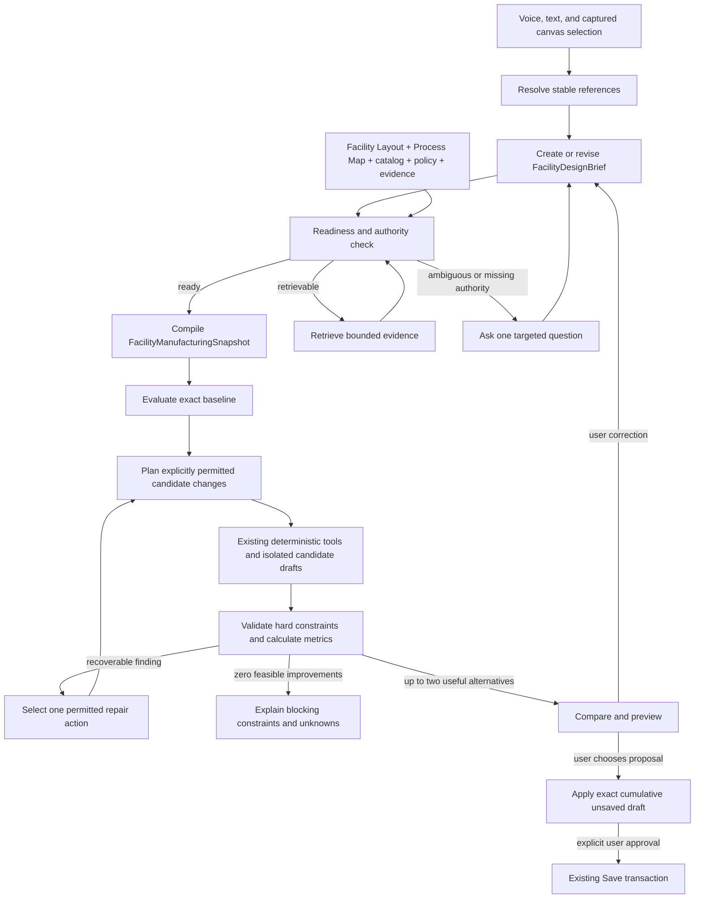

# Facility Sage Persistent Design Loop Implementation Plan

## Revision 6 Semantic-Coverage And Reference-Eligibility Amendment

The deterministic semantic resolver is an optimization for fully understood
language, not a partial-intent extractor. It may create or revise a design brief
only when every instruction clause, target, qualifier, negation, permission,
constraint, and preference relation is consumed by the closed contract. An
unknown target, an unsupported movement bound, an exclusive choice such as
`A or B, but not both`, or a mixed clause whose effects cannot be represented
must use provider interpretation or targeted clarification. Recognizing some
entity labels is never sufficient authority to discard the rest of a sentence.

Correction parsing applies the same rule clause by clause. Locking one entity
must not lock a different entity that the user explicitly permits to move, and
contrastive preference language such as `rather than X, prefer Y` must make `Y`
the primary metric. A deterministic correction that cannot preserve every
understood prior constraint and consume the complete new turn fails closed to
the provider path; it does not update the brief partially.

Loading the archived manual reference in the editor is separate from qualifying
it for manufacturing optimization. FDL9 remains blocked for that layout until a
reviewed objective fixture supplies exact Process Map bindings, transfer
frequency, compatible revision-bound service connectors, and a connected route
chain. UI availability, placement count, labels, route centerlines, and asset
proximity may not substitute for those inputs.

Date: 2026-09-07

Status: Revision 6 is the active acceptance contract. The semantic-coverage
regression and unchanged 20-run rendered-chat benchmark pass. Formal FDL9
promotion still requires named product-owner review and the reviewed manual-
reference inputs described above.

## Revision 5 Acceptance-Evidence Amendment

The six-turn acceptance conversation proves correction, exact proposal Apply,
and exact Undo, but its Turn 3 alternatives both move one placement. Revision 5
therefore adds a separate, uninterrupted preference-order trace against the two
Turn 1 alternatives. The selected result must change from the shorter one-move
alternative to the longer zero-move alternative when fewer moves becomes the
primary preference, then change back when shortest travel is restored.

Revision 5 also permits a fully grounded, unambiguous design request to use the
production deterministic semantic resolver before a provider round trip. The
resolver may run only when it recovers every required user-owned referent,
constraint, permitted change, trip count, and shift from the exact loaded
layout. Incomplete or ambiguous turns continue to provider interpretation. The
browser benchmark must enter through rendered Sage chat, execute the ordinary
brief and preview tools, and record which semantic path handled every sample;
direct runtime calls remain inadmissible evidence.

Date: 2026-09-07

Status: Revision 5 is the active acceptance contract. All automated technical
gates pass; formal FDL9 promotion remains subject to named product-owner review.

## Revision 4 Acceptance Amendment

Strict endpoint validation exposed an inconsistency in the original two-route
acceptance fixture. If `Main Boulevard` is the terminal segment into Input
Buffer B, preserving its exact geometry necessarily prevents Input Buffer B
from moving. The Turn 2 contract nevertheless required both endpoint-buffer
alternatives to remain feasible after that route was locked.

Revision 4 resolves the inconsistency without weakening validation. The
synthetic transfer path now has three continuous route segments: an editable
`Material Transfer Aisle` at the source, an internal `Main Boulevard`, and an
editable `Input Approach Aisle` at the destination. Placement-fit candidates
reflow only the route segment attached to the moved endpoint. This makes the
boulevard lock consequential while retaining two independently valid one-
buffer alternatives for the correction test.

Plan namespace: `FDL0` through `FDL9`

Backlog owner: `FLI-033`

Related experiment: `FLI-032`

## Review Disposition

Revision 2 incorporates every finding from the first independent review:

| Review finding | Revision 2 decision |
|---|---|
| P1: generated-draft Undo loses prior editor history | Add an explicit editor proposal transaction frame in `facility_layout_session.js`; one Undo restores the exact prior draft, history cursor, and prior generation-draft state |
| P1: correction and exact proposal selection conflict | Use a six-turn acceptance conversation: correct first, then select the newly bound proposal in a separate turn |
| P1: generation and FDL leases may conflict | Use one Facility draft-lease namespace with atomic server-side owner transfer inside a coordinated editor adoption transaction |
| P2: hard constraints lack executable definitions | Add a closed constraint-predicate registry and defer adjacency/access kinds from V1 until they have exact predicates |
| P2: durable briefs can outlive referenced artifacts | Add reference-aware ownership, pinning, promotion, expiry, and rebind behavior |
| P2: positive acceptance can avoid success | Make every positive gate require a feasible objective-improved proposal; make both follow-up locks consequential |
| P2: engine-only latency can hide a poor experience | Add browser-measured submission-to-target, submission-to-preview, and correction-to-preview product gates |

The revision also moves executable base validation from FDL0 to FDL1, permits
Sage to receive deterministic verdicts while prohibiting it from authoring them,
compares surviving candidate geometry separately from provenance envelopes, and
requires all selected recipes to finish before proposal classification.

Revision 3 incorporates the remaining transaction and rollout findings from the
second independent review:

| Review finding | Revision 3 decision |
|---|---|
| P1: proposal application is not gated by `agent_write` | Add a separate `design_loop_apply` capability requiring both `design_loop_preview` and `agent_write`; preview and comparison remain available without it, while every apply entry point refuses before lease access |
| P2: replacement failure confuses the original Undo frame with the preceding proposal | Preserve immutable root Undo frame O separately from the immediately preceding installation A; failed `A -> B` replacement restores A's exact eligibility, while explicit proposal Undo still restores O |
| P2: Undo after lease expiry conflicts with lease-owning Undo | Define a local-only recovery branch that restores captured editor history without touching a lease held by a newer writer, including local generation-draft Undo after the original run expires |

## 1. Objective

Implement a persistent, bounded Facility design loop that lets Sage carry one
manufacturing objective through observation, proposal generation, deterministic
evaluation, recoverable correction, comparison, and an unsaved preview.

The first executable objective is deliberately narrow:

> Reduce evidence-backed loaded material travel between one process-bound output
> endpoint and one process-bound input endpoint while preserving every locked
> entity and considering only explicitly permitted layout changes.

The first release must support a continuous conversation in which the user:

1. names the transfer objective and permitted changes;
2. locks equipment or routes;
3. changes priorities in a follow-up turn;
4. asks for the best remaining alternatives;
5. corrects the preferred proposal; and
6. leaves one exact cumulative result in the editor as an unsaved draft.

The saved Facility Layout must remain unchanged until the user uses the existing
Save action. One proposal Undo must restore the exact pre-proposal editor draft
and session history.

This plan does not authorize throughput, capacity, staffing, queueing, ergonomic,
safety, compliance, or production-readiness conclusions.

## 2. Relationship To Existing Plans

This work connects existing architecture rather than creating another Facility
generation stack.

- The G1-G7 and RQ plans continue to own deterministic Facility generation and
  reference-quality layout construction.
- The NAV and FM plans continue to own navigation, journey validation, and
  motion presentation.
- `sage-facility-lab-mode-experiment-plan.md` continues to own the A/B experiment
  for flexible model-first language understanding and tool selection.
- This plan supplies the persistent objective, manufacturing snapshot, metric,
  proposal-evaluation, and cross-tool recovery contracts that Lab Mode currently
  lacks.

Lab Mode must consume the FDL contracts. It must not build a parallel design
memory, evaluator, or run store.

## 3. Verified Starting Point

The following foundations exist and should be extended.

| Existing foundation | Current behavior | FDL use |
|---|---|---|
| `agent_skills/workflow_state.py` | Stores an objective, entities, evidence references, referents, milestones, receipts, clarification state, scope fingerprint, and revision vector | Store only the active design-brief and run references plus compact interaction state |
| `memory/workflow_state_store.py` | Persists session workflow state in SQLite with a 24-hour TTL and compare-and-swap revision updates | Short-lived session pointer, not the durable design-brief home |
| `verified_workflows/runtime.py` | Provides bounded observe, plan, validate, simulate, repair, and preview behavior | State-machine semantics and typed issue/repair patterns |
| `facility_layout/agent_runtime.py` | Uses two repair attempts, 16 workflow tool calls, a 300-second workflow ceiling, and a narrow `no_layout_alternative` repair | Preserve budgets initially and replace one-case repair with a closed recovery registry |
| `facility_layout/facility_planning.py` | Defines evidence-gated process steps, departments, equipment requirements, routes, source revisions, and unresolved findings | Reuse its authority and evidence concepts; do not duplicate its complete-factory package |
| Facility Layout `processBindings` | Canonically bind Process Map IDs/revisions and node/edge IDs to placement and route IDs; attach/edit/detach operations exist | Finish deterministic application after placement IDs exist and compile the objective snapshot |
| `semantic_plan.py` | Validates revision-bound process-binding intent but currently reports `process_binding_application_deferred`; placement relationships remain advisory | Close the binding gap required by the first material-transfer objective |
| `planner.py` | Produces up to four immutable alternatives and measures spatial findings, displacement, accepted routes, route distance, and operation count | Reuse isolated alternatives, but replace its global lexicographic preference with objective-specific evaluation |
| `generation_run_repository.py` | Provides restart-safe runs, cross-process writable leases, atomic records, 24-hour idle expiry, 30-day tombstones, cumulative proposals, Save receipts, and stale handling | Reuse its persistence and concurrency rules for design runs |
| `feature_flags.py` | Enforces ordered Facility and navigation capability dependencies | Add an ordered FDL rollout ladder |
| `facility_layout_spatial_worker.js` | Cancels superseded requests and rejects late worker results by request ID | Extend the same generation-staleness rule to design evaluation and preview |

Current gaps:

1. There is no facility-specific durable design brief.
2. No shared artifact connects process sequence, equipment, transfer endpoints,
   and actual Facility routes for objective evaluation.
3. No objective registry defines what evidence a metric requires.
4. The current planner score is a feasibility-oriented global ordering, not a
   user-priority-aware manufacturing comparison.
5. Recovery handles only one narrow layout-alternative failure.
6. Conversation and canvas selection do not expose one visible, revision-bound
   interpretation state for design work.
7. The reference factory is a geometry benchmark, not manufacturing-optimization
   gold until its process bindings and transfer frequencies are reviewed.

## 4. Product And Authority Boundaries

### 4.1 Sage owns

- interpreting unrestricted user wording into the closed design-brief schema;
- resolving references through trusted observations;
- selecting the next allowed capability;
- selecting one recovery action from a deterministic list;
- sequencing bounded work across existing tools; and
- explaining measured alternatives, unknowns, and conflicts.

### 4.2 Deterministic InspectorPro code owns

- stable entity resolution and ambiguity detection;
- all coordinates, geometry, route centerlines, fit positions, and operations;
- process-binding validation;
- manufacturing-snapshot compilation;
- hard-constraint checks;
- metric calculation and candidate comparability;
- Pareto classification and deterministic tie ordering;
- dependency invalidation, revision checks, and cancellation;
- cumulative diffs, receipts, preview state, Save, and Undo.

### 4.3 The user or reviewed policy owns

- the manufacturing objective;
- which entities and routes are fixed;
- which changes are permitted;
- preference order and any explicit minimum-improvement target;
- transfer frequency and its operating basis;
- accepted assumptions and missing-evidence decisions;
- the preferred alternative; and
- explicit Save approval.

### 4.4 Automatic failures

The implementation fails acceptance if it:

- stores model-authored coordinates in the design brief;
- installs an FDL proposal by clearing or replacing the user's prior editor
  history;
- creates a design-only writable lease namespace beside generation leases;
- silently weakens, deletes, or demotes a hard constraint;
- accepts an unregistered or model-evaluated hard-constraint predicate;
- treats a label match as a process or transfer binding;
- substitutes straight-line distance for an accepted route distance;
- converts loads per shift into trips per shift without authored conversion data;
- reports a per-shift metric when transfer frequency is unavailable;
- combines process sequence, material flow, pedestrian travel, and vehicle travel
  into one ambiguous edge type;
- lets the model calculate or declare that an alternative is improved;
- applies a stale or superseded result;
- exposes or executes proposal application without both `design_loop_apply` and
  `agent_write`, or touches the lease before that check passes;
- applies a corrected proposal in the same turn that first creates its new diff
  and receipt bindings;
- treats the immediately preceding proposal state in a replacement as an
  unexpected editor revision;
- releases, transfers, or rewrites a newer owner's lease during local-only Undo;
- stops candidate evaluation only because the first feasible candidate returned;
- forces a second alternative when only zero or one is feasible;
- describes a bounded candidate set as globally best or optimal;
- continues after its call, repair, elapsed-time, or candidate budget is exhausted;
- saves the layout through model text or blanket approval;
- creates a second source of Facility geometry truth;
- garbage-collects an unsaved base or transaction still owned by an active brief;
- presents the prototype objective as safety, throughput, capacity, or production
  optimization.

## 5. Target Architecture



The model participates in reference interpretation, planning, and selecting from
allowed recovery actions. Every geometry-producing and metric-producing node is
deterministic.

## 6. Artifact Model And Lifetimes

### 6.1 Sources of truth

| Artifact | Authority |
|---|---|
| Saved Facility Layout | Geometry, placements, routes, markings, and persisted process bindings |
| Process Map revision | Process topology and material/precedence edges |
| Catalog/profile revisions | Equipment identity, capability, and physical footprint evidence |
| Shell and policy revisions | Authored site and policy constraints |
| `FacilityDesignBrief` | User objective, hard constraints, preferences, permitted changes, and reviewed decisions |

The design brief is authoritative for design intent only. It cannot contain or
override Facility geometry.

### 6.2 Derived and runtime artifacts

| Artifact | Persistence | Purpose |
|---|---|---|
| `FacilityManufacturingSnapshot` | Immutable expiring design-run artifact | Objective-scoped joined view of process and physical evidence |
| `FacilityDesignBase` | Immutable; pinned by an active brief when the source is unsaved | Exact canonical saved or unsaved draft used by every candidate in the run |
| `FacilityDesignBaseline` | Immutable design-run artifact | Baseline hard-constraint and metric results |
| `FacilityDesignCandidatePlan` | Immutable design-run artifact | Coordinate-free permitted change set |
| Candidate draft | Immutable design-run artifact | Isolated deterministic result from the same base revision |
| `FacilityDesignEvaluation` | Immutable design-run artifact | Feasibility, metrics, unknowns, and affected dependencies |
| `FacilityDesignProposalSet` | Immutable design-run artifact | Up to two presented non-dominated alternatives plus exact approval bindings |
| `FacilityDesignDecision` | Brief-owned immutable artifact | User decision, exact proposal or constraint refs, and authority provenance |
| `FacilityDesignTransaction` | Immutable revisions behind a compare-and-swap head; pinned until Save or Undo, then retained with the run tombstone | Selected operation plan, diff, receipts, root Undo frame, preceding installation state, and lease-adoption record |
| `FacilityDesignRun` | Durable for 24 hours idle | Stage state, counters, receipts, artifacts, and recovery history |
| Workflow state pointer | Session SQLite record, 24-hour TTL | Active brief ID/revision, run ID, selection snapshot, and last proposal ID |

The first proposal application captures root Undo frame `O`. Every installation
attempt also records the immediately preceding installed state and the expected
result with an `installationFingerprint` over canonical draft revision,
proposal ID, transaction revision, editor generation ID, and command-journal
hash. For the first application, the preceding state is `O`. For replacement
`O -> A -> B`, the root remains `O`, the preceding installation is the complete
eligible state `A`, and the expected installation is `B`.

### 6.3 Durable home and concurrency

Add a `FacilityDesignRepository` under the configured Facility Layout artifact
root. It owns both design briefs and design runs without changing the saved
layout schema.

- Brief revisions are immutable content-addressed records.
- A brief head pointer advances by compare-and-swap.
- Active briefs have no time-based deletion. They remain until explicitly
  archived or deleted by an authorized user.
- Design runs expire after 24 hours without activity.
- Run tombstones remain for 30 days.
- Large snapshots, candidate layouts, and evaluations are retrieved by artifact
  handle; they are never serialized into model context or workflow state.
- One cross-process Facility draft lease is allowed per site/layout across both
  generation and FDL runs; FDL cannot create a parallel lease namespace.
- Preview-only candidate runs carry no writable lease and may run concurrently.
- Applying a selected proposal acquires, adopts, or verifies the one writable
  lease and compare-and-swaps against the exact current editor-draft revision.
  Losing either check leaves the candidate artifact inspectable but blocks
  mutation.
- Read-only inspection and comparison may run concurrently with a writable run.
- Extract and reuse the generation repository's atomic-write, lockfile,
  stale-lock, and tombstone mechanisms in the shared lease repository rather
  than relying on an in-process lock. Generation must delegate lease ownership
  to that repository after migration.
- A second process must be included in concurrency tests.
- The repository permits at most 16 active briefs per layout and 256 immutable
  revisions per brief. Reaching either bound returns a named resource finding;
  records are never silently deleted or compacted to make room.

The generic workflow-state record stores only references. Expiration of a chat
session must not delete or corrupt the active design brief.

### 6.4 Exact base state

A design run must bind one `FacilityDesignBase` before it compiles manufacturing
evidence. The allowed base kinds are:

1. an exact saved-layout revision;
2. an active server-held Facility generation or design draft with a complete,
   valid receipt chain; or
3. a browser-authored editor draft captured through an explicit deterministic
   draft-snapshot transaction.

The third path exists so an authorized user's unsaved manual work does not force
the old "save or discard editor changes" dead end. The client submits the
canonical draft, saved-base revision, current editor generation ID, and command
journal hash. The server validates the complete document, computes its draft
revision, verifies that the saved base has not moved, and stores it only as an
immutable run artifact. This is not a Save and does not alter the layout store.

Every base record contains:

```text
baseKind
layoutId
savedLayoutRevision
draftRevision
receiptChainRevision or commandJournalHash
editorGenerationId when browser-authored
sourceAuthority
capturedAt
```

`draftRevision` is the canonical geometry/state hash used for planning and stale
checks. `capturedAt` and the command-journal provenance remain auditable but are
excluded from candidate semantics, so recapturing identical editor bytes cannot
change the generated alternatives.

An editor change during capture or after candidate planning causes a compare-and-
swap failure. Arbitrary browser-local geometry, an unvalidated document, or a
draft whose saved base moved can never become planning evidence.

### 6.5 Shared Facility draft lease and adoption

Generation and FDL use one lease record and one filesystem namespace, owned by a
shared `FacilityDraftLeaseRepository`. A lease identifies:

```text
tenantId / siteId / layoutId
ownerKind: generation_run | design_run
ownerRunId / ownerToken
baseSavedLayoutRevision / currentDraftRevision
status: active | adopting | review_required | released | expired
reviewReason when review_required
priorOwnerRef when adopted
acquiredAt / updatedAt / expiresAt
recoveryDeadlineAt when review_required
leaseRevision
```

Every generation stage checkpoint/amendment/Save, FDL proposal apply/Undo/Save,
and manual persistent `applyOperations` path consults this same repository.
Browser-local manual gestures may continue during preview-only work, but they
advance the editor generation ID and make any older FDL proposal stale.

Preview-only FDL work never acquires or transfers a lease. The service verifies
effective `agent_write` and `design_loop_apply` before even reading this lease
for application. After those checks pass, applying an exact FDL proposal has
three legal ownership paths:

1. a saved or browser-authored base with no current owner atomically acquires the
   lease for the design run;
2. a base owned by an active generation run adopts that same lease from the
   generation owner; or
3. a design run replacing its own active FDL proposal verifies the existing
   owner token and builds a cumulative replacement from the original captured
   pre-proposal frame. V1 never nests proposal transaction frames.

Acquisition and adoption use one coordinated two-phase transaction under the
cross-process site write lock; the plan does not pretend a browser-memory swap
and repository write are one database transaction:

1. **Prepare on server:** verify current lease/run status, owner token, saved
   base, source draft revision, editor generation ID, selected proposal
   bindings, and that no stage checkpoint is in flight. Pin the source draft and
   receipts, mark the lease `adopting`, and return a single-use adoption token.
2. **Prepare in browser:** capture the Section 10.4 session frame, execute the
   proposal against a detached draft clone, validate it, and require its
   canonical revision to equal the proposal's expected result. The visible
   editor remains unchanged.
3. **Commit on server:** compare-and-swap the adoption token and all source
   revisions, transfer or acquire the lease for the design run, persist the
   pinned `FacilityDesignTransaction`, and issue one adoption/apply receipt.
4. **Commit in browser:** swap the already validated clone into the visible
   editor, install `designProposalDraft`, advance the editor generation ID, and
   acknowledge the exact transaction revision.

Success is not reported until the browser acknowledgment is durable. Failure
before server commit aborts the token and restores the prior owner. Failure
after server commit enters `review_required` with
`reviewReason: installation_unacknowledged` and a 120-second recovery deadline,
matching the existing cross-process stale-lock interval.

Recovery compares complete `installationFingerprint` values, not layout bytes
alone:

- **First installation `O -> A`:** observed `A` completes the transaction;
  observed `O` aborts it and restores the prior lease owner, or releases a newly
  acquired lease.
- **Replacement `O -> A -> B`:** observed `B` completes the replacement;
  observed `A` marks `B` failed, compare-and-swaps the transaction head back to
  the exact prior `A` revision, preserves the design lease owner/token, and
  restores A's Save, replacement, and proposal-Undo eligibility. `O` is not
  treated as replacement recovery; it remains the target of an explicit
  proposal Undo.
- Any other installation fingerprint is a named conflict requiring user review.

The recovery path never applies a different proposal or silently discards
visible bytes. Another process cannot acquire a generation, design, or
manual-write lease while the record is `adopting`, `active`, or in an unexpired
`review_required` recovery window.

Lifecycle rules:

- **Undo with valid ownership:** prepare the durable Undo, restore and
  acknowledge the exact pre-proposal editor frame, then mark the design
  transaction undone and atomically return the lease to the still-valid source
  generation run; otherwise release it.
- **Undo after authority loss:** use the Section 10.4 local-recovery path. It may
  conditionally append an audit-only `local_undo_observed` event to the old
  design transaction, but it cannot acquire, renew, release, transfer, or modify
  the current Facility lease or any newer writer's run.
- **Save:** consume the design-owned lease, validate the cumulative receipt
  chain, persist one layout revision, complete the design transaction, and mark
  an adopted source generation run superseded by the saved revision.
- **Cancel before apply:** cancel FDL artifacts without touching the lease.
- **Cancel after apply:** do not silently discard the visible draft. Mark it
  `review_required` with `reviewReason: user_cancelled_after_apply` and retain
  exclusivity until the current lease's ordinary 24-hour idle expiry. Before
  that deadline, only explicit Save or Undo resolves it.
- **Expiry while active in the editor:** never save or restore automatically.
  When the applicable 120-second `recoveryDeadlineAt` or ordinary 24-hour
  `expiresAt` expires, release server write authority and retain the pinned
  transaction. Local Undo must still restore the captured frame. Save must
  reacquire the shared lease and compare-and-swap the saved base, editor
  generation, transaction revision, and cumulative diff; otherwise it is
  blocked as stale. A later writer may proceed only after that release.

### 6.6 Reference-aware retention

Garbage collection walks explicit ownership references rather than deleting all
artifacts with an expired run:

- active brief revisions, their decision records, and accepted
  assumption/evidence references are not age-collected; they remain until an
  authorized archive or delete operation passes the reference-integrity check;
- archived brief records and their decision audit trail remain until explicit
  authorized deletion, but no longer pin an unsaved base unless a live
  transaction or another active brief owns it;
- an active brief pins any browser-authored or generation-draft
  `FacilityDesignBase`, because that state cannot be reconstructed from the saved
  layout alone;
- a selected proposal promotes its operation plan, diff, receipt chain,
  before-state frame, and lease-adoption receipt into a pinned
  `FacilityDesignTransaction` until Save or Undo;
- unselected candidates, baselines, snapshots, and evaluations remain run-owned
  and may expire after 24 idle hours;
- run tombstone cleanup cannot delete a pinned base, decision, or transaction;
  and
- archiving, rebinding, or deleting the final owning brief releases its pins only
  after integrity checks prove that no live transaction or other brief refers to
  them.

Reopening an active brief after run expiry returns the brief and retained base.
Expired derived artifacts appear as `derived_artifact_expired` and may be
recompiled only if every source revision still matches. If a required source is
gone or has moved, readiness becomes `rebind_required`; the system names the
source and does not mutate the brief or layout. Reopening after the 30-day run
tombstone cleanup follows the same rule.

## 7. FacilityDesignBrief V1

### 7.1 Required structure

The immutable brief record separates design semantics from provenance and audit
data:

```text
schemaVersion
briefId
briefRevision
parentBriefRevision
briefSemanticFingerprint
semanticBody
sourceTurnRefs[]
createdBy / createdAt
```

The canonical coordinate-free `semanticBody` contains:

```text
status
tenantId / siteId / workspaceId / layoutId
baseStateRef
objective
scopeRefs[]
hardConstraints[]
preferences[]
permittedChanges[]
assumptions[]
unknowns[]
referents[]
decisionRefs[]
revisionVector
```

`briefRevision` integrity-hashes the complete immutable record except its own
hash. `briefSemanticFingerprint` hashes only normalized active design semantics;
it excludes brief and record IDs, parentage, source-turn references, timestamps,
superseded records, and storage metadata. Stable target IDs and captured source
revisions remain in the semantic fingerprint. Therefore two paraphrases may
create different auditable brief revisions while still proving that they mean
the same thing.

The mutable head pointer carries `updatedAt`; an immutable brief record does not.

The `objective` contains:

- `objectiveId`;
- `objectiveKind` from a closed registry;
- exact process, transfer, area, placement, and route references;
- requested metric IDs;
- optional user-authored minimum-improvement requirements; and
- evidence references.

Each hard constraint contains:

- a stable constraint ID;
- a closed constraint kind;
- exact target IDs and their captured revisions;
- source authority and evidence references;
- `active`, `superseded`, or `withdrawn` status; and
- the explicit user turn or policy that created or superseded it.

Initial hard-constraint kinds:

- `preserve_entity_geometry`;
- `preserve_entity_identity`;
- `preserve_route_geometry`;
- `preserve_process_binding`;
- `remain_inside_area`.

`retain_required_adjacency` and `retain_required_access` are deferred from V1.
They cannot enter a brief until a later registry revision defines exact target
types, contact or access semantics, evidence, and deterministic predicates. A
request for either returns `facility_design_constraint_kind_unsupported`; it is
never downgraded silently to a preference or advisory relationship.

Each permitted change uses a closed-world rule:

```text
target entity IDs + allowed operation kinds + optional containing area ID
```

Anything not explicitly permitted remains unchanged in the first release.

Initial permitted operation kinds:

- move an explicitly named buffer placement within its current area;
- rotate an explicitly named movable placement through deterministic fit
  alternatives;
- edit an explicitly named material route; and
- move a route-bound transfer endpoint only when its associated placement is
  explicitly movable.

### 7.2 Executable constraint-predicate registry

Each supported hard-constraint kind is one closed registry record containing:

```text
constraintKind / predicateVersion
input schema and target entity kinds
required evidence and authority
dependency projection
deterministic validator
baseline capture rule
candidate comparison rule
violation code
missing/stale evidence behavior
```

V1 freezes these predicates:

| Constraint kind | Required data and evidence | Deterministic predicate | Failure behavior |
|---|---|---|---|
| `preserve_entity_geometry` | Stable entity kind/ID, source revision, canonical geometry-projection version and baseline hash | Hash the same behavior-bearing geometry projection before and after; require exact equality | `facility_design_locked_geometry_changed`; missing target is stale, never pass |
| `preserve_entity_identity` | Stable entity kind/ID and source revision | Require the same ID and entity kind to exist exactly once after the candidate | `facility_design_locked_identity_changed`; missing or duplicate identity is terminal |
| `preserve_route_geometry` | Route ID/revision and route-projection version | Require exact canonical equality of centerline, width, direction, aisle kind, and route kind | `facility_design_locked_route_changed`; unknown route evidence is unavailable, never pass |
| `preserve_process_binding` | Binding ID, Process Map ID/revision, node/edge IDs, placement IDs, route IDs, and binding role | Require exact canonical equality of the binding projection and existence of every referenced ID | `facility_design_locked_process_binding_changed`; a stale Process Map blocks evaluation |
| `remain_inside_area` | Movable placement IDs, containing zone ID/revision, exact catalog footprint revisions | Run the existing footprint containment predicate against the exact zone polygon for every target | `facility_design_area_containment_failed`; unknown footprint or zone geometry is unavailable, never pass |

The registry returns each constraint's exact dependency set, result
`satisfied | violated | unavailable | stale`, evidence references, and validator
revision. Only `satisfied` passes hard feasibility. Sage can receive these
deterministic results, but cannot supply, override, or reinterpret them.

Adding any hard-constraint kind requires a schema revision, deterministic
fixture, missing-evidence case, stale case, property test, and tool-knowledge
entry. Free-form predicates and model-evaluated constraints are prohibited.

### 7.3 Preferences

Preferences reference registered metrics and contain an explicit priority rank.
The model cannot invent numeric weights.

Assumptions use `proposed`, `accepted`, or `rejected` review status. Sage may
propose an assumption, but only a user- or reviewed-policy-authorized `accepted`
assumption can affect readiness, candidate generation, or a metric.

Initial preference metrics:

- loaded material travel;
- moved placement count;
- total placement displacement;
- rotated placement count;
- changed route count; and
- affected process-binding count.

When priorities are absent and alternatives trade one metric for another, Sage
must present the alternatives as incomparable and ask the user to choose. It may
not manufacture a preferred score.

### 7.4 Follow-up semantics

- A correction creates a new immutable brief revision.
- Existing active hard constraints remain active unless the user explicitly
  supersedes or withdraws them.
- `Try a U-shaped cell` cannot silently remove `keep inspection fixed`.
- A preference can be reordered without changing hard constraints.
- Conflicting new instructions produce a structured conflict and no brief-head
  update until the user resolves it.
- The UI shows the interpreted objective and target chips before execution.
- `this`, `that`, `these`, `same`, and `other cell` bind to stable IDs captured
  from selection, the last accepted referent, or the named proposal at message
  submission time.
- If more than one valid referent remains, Sage highlights candidates and asks
  one question without mutating the brief or layout.

### 7.5 Bounds

- canonical brief maximum: 65,536 bytes;
- model-visible brief slice maximum: 8,192 canonical bytes;
- active hard constraints: 100;
- preferences: 32;
- permitted-change records: 100;
- assumptions and unknowns: 100 each;
- decision references: 100; and
- full decision records remain external artifacts referenced by ID.

The repository bounds are 16 active briefs per layout and 256 immutable
revisions per brief as defined in Section 6.3. At the revision limit, the user
may explicitly archive the brief and create a successor whose first decision
references the archived final revision; the repository does not erase history.

## 8. FacilityManufacturingSnapshot V1

### 8.1 Scope

The first snapshot supports only one material transfer objective. Its schema may
be extensible, but its populated surface remains narrow.

Required records:

```text
FacilityDesignBase and source revisions
objective and brief refs
process operations
operation-to-equipment bindings
material transfer
physical input/output endpoint refs
accepted route refs or accepted candidate route packages
optional authored loaded-trip frequency
obstacle and route validation context
unknowns and blocking findings
dependency graph
snapshot revision
```

### 8.2 Compilation sources

The compiler joins:

1. one exact Process Map revision;
2. one exact `FacilityDesignBase`, whose saved and draft lineage has already
   passed Section 6.4;
3. canonical accepted `processBindings` in that exact source state that reference
   process node/edge,
   placement, and route IDs;
4. exact catalog revisions for bound equipment;
5. exact route and obstacle validation context; and
6. authored transfer-frequency evidence when provided.

No label-only inference may become a binding. A label match can produce a
candidate that requires review, never an accepted snapshot record.

A process binding present only in an unsaved but valid receipt-bound draft is
eligible as draft evidence and is labelled accordingly. It does not become
persisted evidence until the normal explicit Save transaction succeeds.

### 8.3 Process-binding completion

Complete the deferred semantic-plan step after deterministic placement IDs are
known:

- resolve each binding intent to exact placement and route IDs;
- emit existing `attach_process_binding` or `edit_process_binding` operations;
- validate product, Process Map ID/revision, node/edge existence, placement IDs,
  route IDs, and binding role;
- prevent duplicate binding data on placements;
- preserve binding identity across placement movement; and
- invalidate affected snapshots when any referenced revision or identity moves.

### 8.4 Meaning separation

The snapshot keeps separate records for:

- process precedence;
- material transfer;
- pedestrian journey;
- vehicle journey; and
- presentation playback.

A material edge does not prove an operator path. A process edge does not prove a
material route. Playback does not prove timing or scheduling.

### 8.5 Transfer frequency

V1 accepts only `loadedTripsPerShift` with:

- a positive numeric quantity;
- an authored or controlled evidence reference;
- a named shift basis; and
- an evidence/review status.

`loadsPerShift`, product demand, takt, or batch quantity cannot be converted to
loaded trips without separately authored conversion data. If frequency is
missing, route distance remains measurable but per-shift travel is unavailable.

## 9. Objective And Evaluation Contract

### 9.1 Registered first objective

```text
objectiveKind: reduce_loaded_material_travel_v1
required: source endpoint, target endpoint, process binding, accepted loaded route path
optional: loaded trips per shift
permitted levers: explicit movable buffers and at most two explicit editable material routes
unsupported: timing, capacity, queues, congestion, staffing, safety, compliance
```

### 9.2 Hard feasibility precedes ranking

Every candidate must first prove:

- canonical layout validity;
- no unresolved hard finding inside the objective dependency closure;
- no new or worsened finding outside that closure;
- exact byte preservation for every geometry-locked entity;
- stable identity for identity-locked entities;
- complete source and destination process bindings;
- endpoint reachability through an accepted route;
- no orphaned references;
- all containing-area constraints; and
- current source and validation-context revisions.

An unknown hard-feasibility result is not a pass.

### 9.3 Initial metrics

| Metric | Deterministic definition | Required evidence |
|---|---|---|
| `loadedRouteDistanceMeters` | Sum of canonical segment lengths along the accepted loaded route path, across one or more exact route IDs, between bound endpoints | Accepted route-path solution and current validation context |
| `loadedTravelMetersPerShift` | `loadedRouteDistanceMeters * loadedTripsPerShift` | Authored/controlled loaded trips per named shift |
| `movedPlacementCount` | Count of existing placement IDs whose canonical XZ centers changed beyond the comparison tolerance | Baseline and candidate layouts |
| `placementDisplacementMeters` | Sum of XZ center displacement for moved existing placements | Baseline and candidate transforms |
| `rotatedPlacementCount` | Count of existing placements with changed canonical rotation | Baseline and candidate transforms |
| `changedRouteCount` | Count of existing route IDs with changed canonical geometry or direction | Baseline and candidate routes |
| `affectedProcessBindingCount` | Count of binding IDs in the candidate dependency closure | Compiled dependency graph |

Created assets are reported separately and cannot be hidden inside the movement
metrics.

Empty return travel is excluded from V1 unless a later objective explicitly
binds and validates an empty-return route.

### 9.4 Metric states and provenance

Every metric result contains:

```text
metricId
status: measured | unavailable | incomparable | invalid
value and unit when measured
baseline value
delta and percentage when comparable
source artifact refs
calculation version
qualification
```

Missing frequency produces `loadedTravelMetersPerShift: unavailable`; it never
becomes zero.

### 9.5 Improvement and preference are different

The evaluator assigns separate, non-interchangeable states:

1. `feasible`: every hard check passes;
2. `objective_improved`: the feasible candidate reduces
   `loadedRouteDistanceMeters` versus the baseline by more than the comparison
   tolerance using the same source and evaluator revisions;
3. `non_dominated`: no other objective-improved candidate is equal or better on
   every active comparison metric and strictly better on at least one; and
4. `preferred`: the user's explicit metric-priority order selects it from the
   non-dominated set.

`loadedTravelMetersPerShift` reports the scale of the same route reduction when
reviewed frequency exists; it does not create a second independent improvement.
Disruption metrics never decide whether travel improved. They expose the cost of
that improvement and govern preference only when the user ranks them.

The deterministic evaluator computes feasibility, metric deltas, dominance, and
priority application. If no preference order resolves a tradeoff, return a
Pareto set without a recommendation. Present at most two alternatives. Returning
zero or one is valid. The unchanged baseline remains visible for comparison but
is not disguised as a generated alternative.

The words `best` and `optimal` are prohibited in result claims. The strongest
allowed wording is `preferred among the evaluated bounded alternatives`, and
only when the preference order resolves the choice.

Numeric equality tolerances are frozen as computational comparison tolerances:

- distance: `1e-6 m`;
- area: `1e-6 m2`; and
- integer counts: exact.

These tolerances are not engineering clearances and must never be displayed or
reasoned about as such.

An improvement below a user-authored minimum remains mathematically measured but
must not be described as operationally meaningful.

## 10. Candidate Generation And Isolation

### 10.1 Closed search space

For the first objective, the deterministic candidate generator may consider only:

1. route-only reflow of either explicitly editable material route in the bound
   route path;
2. a physical-fit alternative for one explicitly movable source buffer;
3. a physical-fit alternative for one explicitly movable destination buffer;
4. a combined source/destination buffer alternative when within budget; and
5. route reflow after each permitted placement alternative.

The generator may produce at most four candidates, matching the existing planner
ceiling. It presents at most two non-dominated feasible alternatives.

Candidate recipes are enumerated canonically by lever kind, stable target IDs,
and deterministic strategy ID before any geometry is generated. The run records
`searchStatus: complete | truncated`, the explored recipes, and the unexpanded
frontier count. If the four-candidate ceiling truncates a nonempty frontier, Sage
may report what was found but cannot claim that no better alternative exists.
All selected recipes are evaluated before preference ordering; enumeration order
cannot make the first feasible result win.

The model names semantic levers and constraints. Existing fit, placement,
circulation, routing, spatial, operations, and validation code generates all
coordinates and candidate geometry.

### 10.2 Candidate isolation

- Every candidate starts from the same `FacilityDesignBase`, exact brief
  revision, and brief semantic fingerprint.
- Candidate operations execute in an isolated server artifact.
- Candidate A can never become the base of candidate B.
- A candidate cannot modify an entity outside `permittedChanges`.
- Locked entity subsets are hashed before and after candidate execution.
- Candidate artifacts carry exact source, brief, snapshot, evaluator, and tool
  revisions.
- Rejected candidates retain compact findings but are never shown as successful
  drafts.

### 10.3 Applying a selected proposal

An apply authorization must identify a proposal that already exists before the
authorizing action begins. It may come from a proposal-row selection in the UI or
a later conversation turn whose captured referent resolves to exactly one
proposal ID. A turn that adds or changes a hard constraint invalidates prior
proposals and cannot also authorize application of the corrected proposal that
does not yet exist.

Choosing an alternative binds:

- layout ID and base draft revision;
- base artifact handle, saved-base revision, and editor generation ID when used;
- brief ID, revision, and semantic fingerprint;
- manufacturing snapshot revision;
- proposal and candidate IDs;
- cumulative operation-plan revision;
- exact diff hash;
- dependency fingerprint; and
- every stage receipt.

The selected proposal becomes one unsaved editor draft. Existing Save presents
one cumulative diff bound to the full receipt chain. Any invalidated dependency
blocks Save until the proposal is rebuilt or discarded.

### 10.4 Editor proposal transaction and exact Undo

FDL must not call the current generated-draft installation path unchanged. That
path clears `batches` and `cursor`, and generated-draft Undo restores
`baseLayout`; it cannot satisfy pre-proposal draft restoration.

Extend `static/facility_layout_session.js` with one explicit
`designProposalDraft` transaction state and matching install/Undo/Save transport.
The first proposal installation captures immutable root Undo frame `O`:

```text
baseLayout and baseRevision
draftLayout and draft revision
batches and cursor
selected IDs
prior generatedDraft state, including run/receipt/save bindings
recent receipt IDs
active proposal metadata needed to restore the prior review state
editor generation ID
```

Every first or replacement installation also persists:

```text
rootUndoFrameRef and revision
immediatelyPreviousInstallationStateRef
previous installation fingerprint
previous proposal ID / transaction revision / receipt and Save eligibility
expected installation fingerprint
expected proposal ID / transaction revision / receipt and Save eligibility
```

For first install `O -> A`, the immediately preceding state is `O`, with no FDL
proposal reference. For replacement `O -> A -> B`, it is the full installed
state `A`, including A's canonical draft artifact, `designProposalDraft`
metadata, proposal and transaction revisions, receipt chain, Save eligibility,
editor generation ID, and command-journal hash.

Camera/view state is not reset by proposal installation. The selected FDL
operation plan is applied relative to the captured draft and installed only when
its base revision, editor generation ID, diff hash, brief revision, proposal ID,
and lease-adoption receipt all match.

When the design run replaces its own active proposal, it reuses the first
transaction's captured pre-proposal frame and applies the replacement's complete
cumulative plan to that frame. It records the currently installed proposal as
the immediately preceding installation for failure recovery, but must not make
that state another Undo base or create nested `designProposalDraft` state. A
failed B installation restores A's exact transaction head and eligibility; an
explicit proposal Undo from either A or B restores O.

When the design transaction still owns a valid lease, proposal Undo is
coordinated across the durable transaction and editor:

1. the Undo transport verifies the transaction/lease revisions, marks the
   transaction `undo_pending`, and keeps other writers excluded;
2. the browser restores captured `baseLayout`, `draftLayout`, `batches`,
   `cursor`, selected IDs, receipts, and prior `generatedDraft` object exactly;
3. the browser clears only `designProposalDraft` and its proposal presentation
   state, advances the editor generation ID, and acknowledges the restored draft
   revision plus command-journal hash; and
4. the server completes Undo and returns the lease to the valid prior owner or
   releases it.

If browser acknowledgment is lost, the transaction becomes `review_required`
with `reviewReason: undo_unacknowledged`; reload retries only the persisted
before-state. No competing writer is admitted during the same 120-second
recovery window, and no alternate editor state is synthesized.

If the read-only ownership check instead finds that the lease is expired,
released, owned by another token, or cannot be established, Undo takes a
distinct local-recovery path and never assumes write authority:

1. do not call the lease-owning Undo transport and do not acquire, renew,
   release, or transfer any server lease;
2. restore root frame O's `baseLayout`, `draftLayout`, `batches`, `cursor`,
   selection, receipts, and prior `generatedDraft` state in the old browser;
3. clear the local `designProposalDraft` and expose a
   `stale_local_restore` authority state outside the restored frame; and
4. disable Save and further proposal application until the user binds and
   validates a current base.

The new writer's lease record, owner token, run, draft, and saved layout remain
byte-identical. The restored local draft and history are exact even when their
saved base is now stale; no merge or server rollback is implied.

The next Undo follows the restored history. For a manual draft it moves from the
restored cursor to the preceding manual batch. For a restored generation draft,
the session first obtains read-only run/lease eligibility. If the original run
is active and owns the exact lease, it uses the existing generation Undo
transport. If the run expired, lost its lease, or cannot prove ownership, it
performs a local-only generation-draft Undo to the captured `baseLayout`, clears
local `generatedDraft`, keeps `stale_local_restore`, and does not call the writable
generation transport or touch the current lease owner. FDL proposal Redo is not
automatic in V1 because its revisions may be stale; the prior manual redo branch
is restored with the captured cursor and can behave normally.

Required editor-session fixtures:

- make two manual edits, apply an FDL proposal, Undo once to recover the exact
  two-edit draft and history, then Undo again to recover the exact one-edit draft;
- begin from an active generation draft, adopt and apply an FDL proposal, Undo
  once to recover the byte-identical generation draft and metadata, then Undo
  again through the generation transport;
- execute `O -> A -> B`, fail after B's server commit while the browser still
  displays A, restore A's exact proposal/transaction/receipt/Save eligibility,
  then explicitly Undo A back to O;
- apply a proposal, expire and release its lease, let another process acquire the
  lease, then Undo from the old session and prove exact local history restoration
  plus byte-identical ownership and state for the new writer;
- repeat that expiry case with O as a generation draft whose run has expired,
  then prove the following Undo removes the generation draft locally without a
  writable transport call or lease mutation;
- inject failure before and after server lease adoption and during Undo; prove
  exact editor restoration and compare-and-swapped server ownership recovery;
  and
- reload an active FDL transaction and prove Save/Undo eligibility from the
  durable transaction record rather than an in-memory pointer.

## 11. Readiness And Recovery

### 11.1 Readiness states

| State | Meaning | Required behavior |
|---|---|---|
| `ready` | Required evidence and authority are available | Compile and evaluate |
| `retrievable` | Evidence exists but is not in the current bounded context | Retrieve exact slice, then retry readiness |
| `ambiguous` | Multiple exact entity candidates remain | Highlight candidates and ask one question |
| `choice_open` | Several permissible design choices exist | Generate and compare alternatives |
| `missing_authority` | A required value or profile has no authored/controlled source | Name the missing evidence and ask for it |
| `constraint_conflict` | Active requirements cannot all hold | Name the conflicting constraint IDs and permitted resolutions |
| `rebind_required` | A durable brief's required base or source is unavailable or moved | Name the missing source and wait for an explicit new base binding |
| `unsupported` | The requested conclusion exceeds available capability | Refuse with a stable code and no mutation |
| `stale` | A bound source revision changed | Cancel, mark artifacts superseded, and block apply/Save |
| `stale_local_restore` | Captured browser history was restored after write authority was lost or could not be proven | Permit inspection and further local Undo; block apply/Save until an explicit current-base rebind validates the draft |

### 11.2 Closed recovery registry

Deterministic findings return zero or more `FacilityRecoveryAction` records. An
action contains an ID, supported finding codes, exact affected IDs, permitted
tool, allowed parameter bounds, preserved constraints, expected postcondition,
and cost against the remaining run budget.

Initial recovery actions:

| Finding | Permitted recovery |
|---|---|
| `no_layout_alternative` | Add the next deterministic strategy already allowed by the brief |
| `route_blocked` | Reflow the same editable route through current free space using existing authored width/clearance |
| `placement_no_fit` | Try the next deterministic orientation or fit candidate for the same explicitly movable placement |
| `ambiguous_reference` | Highlight candidates and ask; no automatic selection |
| `evidence_not_loaded` | Retrieve the named bounded artifact slice |
| `derived_artifact_expired` | Recompile from the retained base only when every exact source revision still matches |
| `frequency_unavailable` | Continue with unweighted route distance or ask only when the user requested per-shift impact |
| `base_rebind_required` | Ask the user to bind an exact current base; never substitute the newest layout silently |
| `constraint_conflict` | Present exact constraints and user-selectable relaxations; never relax automatically |
| `source_revision_changed` | Terminate the current attempt and recompile only from a new user-visible base |

Sage may select only a returned action ID. It cannot edit the action parameters,
invent another repair, or convert a `human_required` or `terminal` finding into a
recoverable one.

### 11.3 Stop conditions

A first feasible candidate is not a stop condition. Unless a terminal condition
intervenes, the runtime evaluates every canonical recipe selected before
execution and every permitted replacement attempt, then performs proposal
classification once over the settled result set.

The loop stops when:

- all selected recipes are evaluated and the final proposal artifact contains
  one or more feasible objective-improved alternatives;
- the complete bounded search contains no objective-improved candidate;
- the truncated bounded search has finished, reported what it did and did not
  examine, and cannot continue within budget;
- a human decision or missing authority is required;
- two recovery attempts are consumed;
- 16 workflow tool calls are consumed;
- 300 seconds of design-runtime elapsed time are consumed;
- the user cancels or changes the objective;
- a source revision changes; or
- an unrecoverable validator or persistence error occurs.

Model text cannot enqueue another run. Continuation across a Facility-agent turn
boundary is server-driven from a persisted next-stage receipt.

## 12. Conversation And Canvas State

At message submission, capture:

- layout and draft revisions;
- selected stable IDs and selection fingerprint;
- active view and focused area;
- base artifact handle and saved/draft lineage;
- brief ID, revision, and semantic fingerprint;
- last proposal ID;
- last explicitly resolved referents; and
- client request generation ID.

Before execution, show the interpreted objective, targets, locks, and permitted
changes in a collapsible Design Brief pane. A user can correct them before a
candidate run begins.

Every asynchronous result carries the client generation ID plus base, brief, and
snapshot revisions. A result is ignored when any of those no longer match.

User correction behavior:

- cancel outstanding workers and server continuation;
- create a new brief revision;
- invalidate only dependent baseline, candidate, and evaluation artifacts;
- retain byte-identical unrelated artifacts when their dependency fingerprints
  remain valid; and
- prevent an older result from replacing the current preview.

Voice is only another input adapter. It uses the same captured selection and
brief-update contract as typed text.

## 13. Tool And Feature Surface

### 13.1 New Sage-visible tools

| Tool | Effect | Purpose |
|---|---|---|
| `inspect_facility_design_brief` | `read` | Return the bounded active objective, constraints, priorities, unknowns, and exact referents |
| `update_facility_design_brief` | `design_state_edit` | Create a new immutable brief revision through a validated semantic patch |
| `run_facility_design_preview` | `preview` | Start or resume the bounded baseline, candidate, evaluation, and recovery workflow |
| `apply_facility_design_proposal_draft` | `draft_edit` | Apply one exact proposal as the cumulative unsaved editor draft |

`design_state_edit` is a new explicit effect class. It changes a design artifact,
not the saved layout or current editor geometry. Tool policy, receipts, and UI
copy must preserve that distinction.

The canonical knowledge registry, effect validator, authorization mapping, audit
record, and mutation-path explanation must all learn this effect together. Its
receipt is a `facility_design_brief_revision_receipt`; reverting it creates a new
brief revision that restores prior semantics rather than deleting history.

`apply_facility_design_proposal_draft` is the only new FDL tool permitted to use
`draft_edit`, and only after an exact proposal-selection turn binds its proposal,
brief, base, diff, and receipt revisions. Do not broaden the Facility agent's
allowlist to arbitrary `draft_edit` commands. This tool can change the unsaved
editor draft but can never invoke `persistent_save`.

The apply tool is advertised to Sage and enabled in the UI only when both
`design_loop_apply` and the existing `agent_write` capability are enabled. Its
service/transport entry point independently repeats both checks before draft
preparation, lease lookup, acquisition, adoption, or renewal, checking
`agent_write` first and `design_loop_apply` second. A direct or stale client call
without either capability returns the existing
`facility_feature_disabled` code naming `agent_write` or `design_loop_apply` in
`details.capability`, changes no editor, run, transaction, or lease state, and
leaves proposal comparison available through `design_loop_preview`.

The runtime internally invokes existing inspection, fit, spatial, circulation,
routing, operation, and validation capabilities. It must not duplicate their
implementations inside the new high-level tool.

### 13.2 Feature-flag ladder

Add:

```text
design_brief
  -> manufacturing_snapshot
  -> objective_evaluation
  -> design_loop_preview
       -> design_loop_apply
       -> design_loop_lab
       -> design_loop_sage
```

Proposed environment prefix:

```text
INSPECTORPRO_FACILITY_LAYOUT_DESIGN_BRIEF
INSPECTORPRO_FACILITY_LAYOUT_MANUFACTURING_SNAPSHOT
INSPECTORPRO_FACILITY_LAYOUT_OBJECTIVE_EVALUATION
INSPECTORPRO_FACILITY_LAYOUT_DESIGN_LOOP_PREVIEW
INSPECTORPRO_FACILITY_LAYOUT_DESIGN_LOOP_APPLY
INSPECTORPRO_FACILITY_LAYOUT_DESIGN_LOOP_LAB
INSPECTORPRO_FACILITY_LAYOUT_DESIGN_LOOP_SAGE
```

Dependencies:

- `design_brief` depends on `viewer_v2`;
- `manufacturing_snapshot` depends on `design_brief`, `constraints`, and
  `routing`;
- `objective_evaluation` depends on `manufacturing_snapshot`;
- `design_loop_preview` depends on `objective_evaluation` and `agent_preview`;
- `design_loop_apply` depends on `design_loop_preview` and `agent_write`;
- `design_loop_lab` depends on `design_loop_preview` and the development-only
  Lab Mode flag; it remains preview-only when `design_loop_apply` is disabled;
  and
- `design_loop_sage` depends on `design_loop_preview` and `agent_preview`. The
  release process must refuse enablement without a successful FDL9 promotion
  receipt; Lab Mode availability alone is insufficient. Sage can inspect and
  compare with this flag while application remains independently gated by
  `design_loop_apply` and `agent_write`.

Production Sage and Lab Mode remain selectable as separate run modes during A/B
evaluation. They consume the same FDL contracts and deterministic runtime.

No new Save capability is introduced.

### 13.3 Proposed module ownership

New modules under `ai_inspector/facility_layout/`:

| Module | Owns | Must not own |
|---|---|---|
| `design_brief.py` | Closed brief schema, semantic patches, normalized semantic fingerprint, conflicts | Geometry, metrics, persistence |
| `design_repository.py` | Immutable briefs/runs/artifacts, CAS heads, reference pins, expiry, tombstones | Planning policy, leases, or layout mutation |
| `facility_draft_lease.py` | One shared generation/design lease namespace, atomic server-side owner transfer, coordinated editor adoption, restoration and consumption | Draft geometry or run-specific planning state |
| `design_base.py` | Saved/draft/editor base capture, validation, lineage, canonical draft revision | Save or candidate generation |
| `manufacturing_snapshot.py` | Objective-scoped joins, readiness, exact dependency graph | Label inference or candidate ranking |
| `design_evaluator.py` | Metric registry, feasibility, comparability, Pareto and preference facts | Geometry generation or model judgment |
| `design_candidates.py` | Canonical recipe enumeration, isolated execution, search completeness | New fit, routing, or validation algorithms |
| `design_runtime.py` | Bounded stages, recovery-action selection, cancellation, resume, trace | Independent tool implementations or Save |

Existing-module changes remain narrow:

- `semantic_plan.py` completes deferred process-binding operations;
- `generation_run_repository.py` delegates layout lease ownership to the shared
  Facility draft-lease repository without changing existing generation receipts;
- `agent_runtime.py` exposes the FDL tools and persisted continuation;
- `tool_knowledge.py` and skill contracts publish capability/effect metadata;
- `feature_flags.py` enforces the rollout ladder;
- service and host layers expose bounded artifact and run endpoints; and
- the Facility workspace renders the brief, comparison, source state, and
  proposal overlays using existing Plan/3D state.

`planner.py`, fit, spatial, circulation, routing, operations, and validation stay
the implementation owners for their current deterministic behavior. FDL calls
them; it does not fork them.

## 14. Budgets And Limits

The first implementation retains current platform limits and adds the smallest
explicit FDL-specific bounds needed for the vertical slice:

| Limit | Value | FDL rule |
|---|---:|---|
| Facility agent tool calls per turn | 10 | Never raise for FDL; span stages through persisted receipts |
| Tool response | 16,384 bytes | Return artifact handle plus bounded summary |
| Skill context | 12,000 estimated tokens | Target at most 9,600 estimated tokens using the current bytes/4 estimator |
| Model-visible brief slice | 8,192 canonical bytes | Deterministically select active records only |
| Verified workflow repairs | 2 | Preserve for the first objective |
| Verified workflow tool calls | 16 | Counts deterministic tool executions across observe, compile, candidates, evaluation, repair, and preview |
| Verified workflow elapsed time | 300,000 ms | Fail closed and retain resumable trace |
| Candidate lineages | 4 | Matches the existing planner alternative maximum |
| Candidate execution attempts | 6 | Four candidate lineages plus at most two bounded repairs |
| Alternatives presented | 2 | Zero or one remains valid |
| Operations per atomic batch | 500 | Split only with dependency-bound receipts |
| Unacknowledged editor apply/Undo recovery | 120 seconds | Matches the existing cross-process stale-lock interval; then release authority without mutating browser state |
| Design-run idle expiry | 24 hours | Same as generation runs |
| Run tombstone retention | 30 days | Same as generation runs |

Every artifact-producing stage must fail before excessive allocation. Context,
response, operation, candidate, and elapsed-time limits are checked before the
next stage begins.

The worst-case preview call schedule is explicit:

| Work | Maximum workflow tool calls |
|---|---:|
| Validate/retrieve `FacilityDesignBase` | 1 |
| Compile manufacturing snapshot | 1 |
| Evaluate baseline | 1 |
| Enumerate canonical candidate recipes | 1 |
| Execute and evaluate four candidate lineages | 4 |
| Execute at most two replacement repair attempts | 2 |
| Reclassify and create the proposal artifact | 2 |
| Reserved for one bounded evidence retrieval and final preview validation | 2 |
| Total | 14 |

Candidate build, validation, and metric calculation form one deterministic
workflow tool call per attempt with internal substage receipts. They are not
additional Sage/provider calls. Two calls remain as hard headroom; any path that
would require a seventeenth workflow tool call stops before execution.

Performance gates use the checked-in
`tests/fixtures/facility_layout/performance/standard-hardware-profile.json`:

```text
machine             Dell 15 DC15250
operating system    Microsoft Windows 11 Home 10.0.26200, build 26200
CPU                 13th Gen Intel Core i7-1355U
cores               10 physical, 12 logical
RAM                 16,849,256,448 bytes
Python              CPython 3.14.0
server              one local Facility server worker
power/workload      AC power; no intentional competing benchmark workload
```

FDL0 records the exact Python, dependency, browser, server-build, evaluator, and
fixture hashes used by each baseline. A changed runtime profile starts a new
baseline rather than being compared silently.

## 15. First Acceptance Fixture And Conversation

### 15.1 Fixture

Create `fdl-material-travel-v1` as a reviewed, synthetic, disposable Facility
fixture containing:

- one Machining operation and one Inspection operation in an exact Process Map;
- one persisted process binding for each operation;
- one persisted material-transfer edge binding;
- a Machining output FIFO and Inspection input FIFO with stable placement IDs;
- one accepted loaded route path between their exact service endpoints using
  three stable route IDs: `Material Transfer Aisle`, `Main Boulevard`, and
  `Input Approach Aisle`;
- two movable buffer placements;
- two fixed machine placements;
- all three route IDs initially permitted to reflow, so locking `Main Boulevard`
  removes a real candidate lever;
- obstacles that make route-only and buffer-relocation alternatives materially
  different;
- exactly 24 authored loaded trips per named shift;
- at least two objective-improved candidates in Turn 1, including one whose
  operation plan changes `Main Boulevard` and one that does not;
- after the Turn 2 boulevard lock, at least two objective-improved candidates
  with a real disruption/travel tradeoff: the frozen lower-disruption proposal
  moves `Output Buffer A`, while another candidate leaves it fixed; and
- the Turn 4 output-buffer lock removes that frozen lower-disruption proposal
  and leaves exactly one separately reviewed objective-improved corrected
  proposal that preserves both locks and remains applicable.

FDL0 records exact geometry, revisions, baseline route length, baseline
loaded-travel metric, candidate operation-plan hashes, which candidates each lock
must remove, and every expected delta. No test derives those values from labels.

### 15.2 Gradeable conversation

The positive conversation runs with effective `agent_preview`, `agent_write`,
`design_loop_preview`, and `design_loop_apply` capabilities. The write-disabled
matrix is graded separately in FDL8 and starts from the same fixture bytes.

Turn 1:

> Reduce loaded material travel from Machining Output FIFO to Inspection Input
> FIFO. Keep CNC Mill 03 and Inspection Station 02 fixed. You may move Output
> Buffer A and Input Buffer B, and you may reroute Material Transfer Aisle,
> Main Boulevard, and Input Approach Aisle. Use the reviewed 24 loaded trips
> per Day Shift.

Expected:

- brief created with exact IDs;
- both machines are hard geometry locks;
- only the two buffers and three named routes are mutable;
- the baseline and all selected recipes are measured before classification;
- at least two objective-improved alternatives are available, including the
  frozen candidate that changes Main Boulevard;
- no layout is saved.

Turn 2:

> Keep the current Main Boulevard fixed too.

Expected:

- the aisle ID is added as a hard geometry lock;
- its prior permitted-change record is withdrawn atomically, while machine locks
  and unrelated permitted changes from Turn 1 remain;
- superseded candidate work is cancelled;
- the frozen Main-Boulevard-changing candidate is removed;
- only dependent candidates and metrics are rebuilt; and
- any surviving operation plan and geometry payload stays byte-identical even
  though its brief, validation, and provenance envelopes receive new revisions.

Turn 3:

> Show me the best remaining options. Prefer fewer equipment moves over the
> shortest route.

Expected:

- preference order is updated without changing hard constraints;
- at least two reviewed objective-improved alternatives remain and up to two
  non-dominated alternatives are presented;
- measured route and disruption deltas are shown separately; and
- `best` is answered as `preferred among the evaluated bounded alternatives`,
  with any search truncation disclosed.

Turn 4 - correction only:

> Keep Output Buffer A exactly where it is. Rebuild the lower-disruption option
> under that lock and show me the corrected proposal. Do not apply it yet.

Expected:

- Output Buffer A becomes a hard geometry lock;
- its prior permitted-change record is withdrawn atomically;
- the earlier named proposal is invalidated rather than blindly reused;
- the frozen lower-disruption proposal that moved Output Buffer A is removed,
  proving that this lock is consequential;
- other incompatible proposals are superseded;
- the fixture's one reviewed objective-improved corrected proposal is fully
  evaluated and shown with a new proposal ID, exact diff, metrics, and receipts;
  and
- no proposal is installed in the editor on this turn.

Turn 5 - exact selection:

> Apply the corrected lower-disruption proposal you just showed me. Do not save
> it.

Expected:

- the displayed referent resolves to exactly one proposal ID captured at message
  submission;
- the exact proposal/base/brief/diff/receipt bindings are revalidated;
- the proposal is installed through `designProposalDraft` as one unsaved editor
  transaction; and
- the saved-layout revision remains unchanged.

Turn 6:

> Undo that.

Expected:

- one Undo restores the exact pre-proposal draft and editor-session frame;
- the design brief remains available as design intent but its applied-proposal
  reference is cleared; and
- the saved-layout revision remains unchanged.

### 15.3 Preference-order selection proof

Run this supplemental trace from the original Turn 1 state, before locking Main
Boulevard:

1. Submit the exact Turn 1 request and record both evaluated alternatives.
2. Submit `Prefer fewer equipment moves over the shortest loaded route.`
3. Submit `Now prefer the shortest loaded route over fewer equipment moves.`

Expected:

- all three turns retain the same hard constraints and two evaluated
  alternatives;
- Turn 1 selects the shorter one-move Output Buffer A alternative;
- Turn 2 selects the longer zero-move Main Boulevard alternative;
- Turn 3 selects the original shorter one-move result again;
- the two distinct result-layout revisions and all metric values are preserved
  in machine-readable evidence; and
- no layout is applied or saved.

## 16. Implementation Phases

### FDL0 - Freeze Baseline, Decisions, And Gold Fixture

Tasks:

1. Freeze current provider, model, reasoning effort, feature flags, skill and
   tool-contract revisions, and all limits from Section 14.
2. Re-run the adjacent Facility, Process Map, workflow-memory, generation-run,
   planner, routing, navigation, transport, session, and workspace tests.
3. Fix or explicitly quarantine every existing failure with a written reason.
4. Create and independently review `fdl-material-travel-v1`.
5. Record Shadrack as the synthetic prototype-fixture approver in a revision-
   bound receipt. That approval establishes test gold only; it grants no
   manufacturing, safety, compliance, or production authority.
6. Record exact baseline metrics and candidate expectations through the running
   deterministic engines.
7. Capture current production-Sage behavior for the six-turn conversation plus
   held-out paraphrases, ambiguity, conflict, stale-result, and unavailable-
   frequency cases.
8. Freeze canonical schema limits, repository paths, retention, lease behavior,
   metric tolerances, and performance protocol.
9. Freeze fixtures and expected revision/authority behavior for all three
   proposed `FacilityDesignBase` kinds; FDL0 does not execute contracts that FDL1
   has not implemented.
10. Record the manual reference-layout hash and confirm whether reviewed process
    bindings and transfer frequencies exist; do not infer them.

Exit gates:

- baseline test state is explained and reproducible;
- fixture bytes and expected metric artifacts are frozen;
- every numeric metric has an independent calculation fixture;
- the named prototype approver and exact approval scope are recorded;
- all three base-kind fixtures and their expected accepted/refused outcomes are
  independently reviewed;
- all source revisions and the effective model ID are recorded;
- the manual reference is unchanged; and
- no production feature flag is enabled.

### FDL1 - Design Brief Contract, Repository, And Referents

Tasks:

1. Implement closed canonical `FacilityDesignBrief` validation and revisioning.
2. Implement separate brief-record integrity revisions and normalized semantic
   fingerprints.
3. Validate revision-bound `baseStateRef` records without storing base geometry
   in the brief.
4. Implement immutable brief records and compare-and-swap head updates.
5. Implement cross-process locking and concurrency fixtures.
6. Store only brief references in generic workflow state.
7. Implement semantic brief patches for add, supersede, withdraw, reorder, and
   correct operations.
8. Bind canvas selection and conversation referents to stable IDs and captured
   revisions.
9. Add bounded brief inspection and tool-knowledge entries.
10. Add a read-only Design Brief pane showing objective, targets, locks,
   permitted changes, preferences, assumptions, and unknowns.
11. Implement `FacilityDesignBase` validation for saved, receipt-bound draft, and
    browser-authored editor-draft sources from Section 6.4.
12. Implement the V1 constraint registry metadata and reject every unregistered
    kind, including deferred adjacency and general-access constraints.
13. Implement the reference ownership graph, pin counts, and integrity-checked
    release rules from Section 6.6.

Exit gates:

- semantically equivalent brief updates have identical semantic fingerprints,
  while their provenance-bearing brief revisions remain independently auditable;
- changing only audit time or source-turn ID cannot change candidate semantics;
- hard constraints survive unrelated follow-ups byte-identically;
- conflicting updates do not advance the brief head;
- ambiguous references cause no mutation;
- session expiry does not delete the brief;
- two processes cannot both advance the same brief head;
- no coordinate field is accepted anywhere in the brief;
- a validated unsaved editor draft can become a base artifact without changing
  the saved layout, while a concurrently changed or invalid draft is rejected;
- every hard constraint carries a registered predicate version and dependency
  projection;
- an active brief reopens with its unsaved base intact after run expiry and
  tombstone cleanup; and
- unowned expiring artifacts are collected while pinned artifacts are retained.

### FDL2 - Minimal Manufacturing Snapshot And Process Bindings

Tasks:

1. Implement post-placement application of validated process-binding intent.
2. Compile exact Process Map operation and material-edge identities.
3. Resolve operation-to-equipment and transfer-to-route bindings by stable ID.
4. Resolve source and destination service endpoints from authored geometry.
5. Add optional reviewed `loadedTripsPerShift` evidence.
6. Build the immutable objective-scoped snapshot and dependency graph.
7. Implement readiness classification and bounded evidence retrieval.
8. Add stale, missing, ambiguous, and conflicting binding fixtures.

Exit gates:

- every accepted snapshot reference exists at the exact recorded revision;
- no label-only binding is accepted;
- process bindings survive equipment movement without ID churn;
- referenced deletion remains blocked;
- unavailable frequency remains explicitly unknown;
- process, material, pedestrian, and vehicle relationships remain distinct; and
- identical source artifacts produce byte-identical snapshot revisions.

### FDL3 - Objective Registry And Deterministic Evaluator

Tasks:

1. Implement `reduce_loaded_material_travel_v1` and its evidence requirements.
2. Calculate the seven metrics in Section 9.3 for baseline and candidate.
3. Execute every registered V1 hard-constraint predicate before metric ranking.
4. Implement metric status, provenance, comparability, and qualification.
5. Implement separate feasible, objective-improved, non-dominated, preferred,
   and operationally-meaningful classifications.
6. Implement Pareto classification and user-priority ordering.
7. Remove objective preference from the existing global planner score for this
   path; retain that score only as an internal deterministic generation order.
8. Add independent arithmetic and metamorphic tests.

Exit gates:

- evaluator results are byte-identical for identical inputs;
- every V1 hard-constraint predicate passes, violates, becomes unavailable, and
  becomes stale in an independent fixture with its named code;
- independent calculations match every measured fixture value;
- missing frequency blocks only the weighted metric;
- a worse higher-priority metric prevents preferred classification;
- unranked tradeoffs remain incomparable;
- disruption affects preference but cannot be reported as proof that travel
  improved;
- zero and one feasible-alternative results are valid; and
- the model cannot submit metric values, evaluation verdicts, or global-best
  claims.

### FDL4 - Bounded Candidate Generator And Isolated Execution

Tasks:

1. Implement the closed V1 search space from Section 10.1.
2. Canonically enumerate candidate recipes before geometry generation.
3. Reuse fit, spatial, circulation, routing, operations, and validation modules.
4. Build each candidate from the same immutable `FacilityDesignBase`.
5. Enforce the permitted-change allowlist at operation compilation and after
   execution.
6. Hash locked entity subsets before and after every candidate.
7. Build exact candidate dependency closures.
8. Produce up to four candidate artifacts and evaluate every one with FDL3.
9. Bind up to two presented proposals to exact cumulative diffs and receipts.
10. Record complete versus truncated search and preserve the canonical unexplored
   frontier count.

Exit gates:

- no candidate modifies an unlisted entity;
- all locked geometry is byte-identical;
- candidate order does not affect candidate bytes or evaluation;
- route distance uses accepted route geometry only;
- failed candidates cannot leak into the active draft;
- candidate B never depends on candidate A;
- no run exceeds four candidate lineages or six total execution attempts;
- a truncated search never produces a global-best or no-improvement claim;
- isolated candidate execution never mutates the immutable source-base bytes.

### FDL5 - Durable Bounded Design Runtime And Recovery

Tasks:

1. Adapt the verified-workflow state machine to durable design-run artifacts.
2. Persist every stage, input fingerprint, output handle, finding, recovery
   action, counter, and receipt.
3. Implement the readiness and recovery registries from Section 11.
4. Enforce two repairs, 16 workflow tool calls, 300 seconds, four candidate
   lineages, and six total candidate execution attempts.
5. Implement server-driven continuation across ten-call Facility turns.
6. Bind the effective provider, model, reasoning effort, brief revision, and all
   dependency revisions before the first provider call.
7. Implement cancellation, stale marking, partial dependency invalidation, and
   restart recovery.
8. Add multi-process writable-lease and process-restart fixtures.
9. Persist validated `FacilityDesignBase` artifacts, including the browser-
   authored draft-snapshot transaction.
10. Generalize the existing generation lease into the one shared
    `FacilityDraftLeaseRepository`; do not add a design-only lease directory.
11. Implement atomic server-side generation-to-design owner transfer inside the
    coordinated editor-adoption protocol, including failed-apply restoration,
    `O -> A -> B` replacement rollback, Undo return/release, Save consumption,
    cancellation, and expiry behavior from Section 6.5.
12. Keep preview runs lease-free; acquire, adopt, or verify the shared writable
    lease only when applying a selected proposal to the live editor draft and
    only after both `design_loop_apply` and `agent_write` pass at the service
    boundary. Failed capability checks occur before any lease-repository call.
13. Promote selected proposal artifacts into a pinned
    `FacilityDesignTransaction` and implement reference-aware collection.
14. Expose a read-only transaction/run/lease eligibility check for editor Undo;
    authority-lost local recovery must not call a mutating lease method.

Exit gates:

- a recoverable fixture is corrected within two attempts;
- human-required findings never enter repair;
- model text cannot enqueue a continuation;
- no turn exceeds ten Facility tool calls;
- restart resumes after the last completed stage without replay;
- a second writable run is rejected across processes;
- with preview enabled and `agent_write` disabled, baseline/candidate comparison
  completes while apply returns `facility_feature_disabled` with
  `details.capability: agent_write` before lease lookup and leaves every
  lease/transaction/editor revision unchanged;
- an FDL proposal based on a still-active generation draft completes coordinated
  editor adoption with one atomic server-side owner transfer, and a competing
  process remains rejected throughout;
- failed apply and valid-ownership exact Undo restore the prior lease owner,
  while Save consumes the design owner exactly once;
- a failed B replacement observed at A restores A's exact transaction head,
  receipts, Save/replacement/Undo eligibility, and unchanged design lease owner;
- after lease expiry and acquisition by another writer, an old-session Undo
  cannot change the new lease revision, owner token, run, draft, or saved layout;
- read-only alternatives remain inspectable while another session holds the
  writable lease;
- a dirty editor draft captured at revision N can be planned against without
  Save, while revision N+1 invalidates the result;
- late or stale results never replace a current preview;
- active brief and transaction pins survive run expiry and tombstone cleanup;
  and
- budget exhaustion is terminal, named, and non-mutating.

### FDL6 - Sage And Lab Mode Integration

Tasks:

1. Add the three always-preview-visible tools plus conditional proposal-apply
   tool and effect metadata from Section 13.
2. Update skill contracts, tool knowledge, orchestration, and API transport.
3. Let Lab Mode produce strict semantic brief patches rather than feature-
   specific command phrases.
4. Expose the smallest stage-appropriate contract and brief slice.
5. Return structured findings and recovery actions to Sage.
6. Require Sage to choose an allowed action ID or ask the user.
7. Preserve deterministic fast paths when behavior is equivalent.
8. Keep Save unavailable to the Facility chat tool policy.
9. Implement `design_loop_apply` and require the effective `agent_write`
   capability both when assembling Sage tools and again at direct apply
   transport execution.

Exit gates:

- held-out paraphrases converge on equivalent semantic fingerprints and
  deterministic outcomes;
- missing command verbs do not cause `not_applicable` for supported intent;
- Sage never receives coordinate-authoring fields;
- Sage receives bounded deterministic metric values, verdicts, qualifications,
  and source references needed to explain or choose a returned recovery action,
  but cannot author or override any of them;
- every tool effect resolves through the canonical registry;
- preview-only configurations omit the apply tool from Sage's callable set, and
  direct/stale clients receive `facility_feature_disabled` naming the missing
  capability without a lease or transaction change;
- provider/model mismatch fails before the first Facility provider call;
- unsupported claims refuse deterministically; and
- production Sage remains available for A/B comparison.

### FDL7 - User Interaction, Comparison, And Correction UI

Tasks:

1. Complete the collapsible Design Brief pane.
2. Show exact target chips, lock indicators, preference order, unknowns, and
   source status.
3. Show bounded stage progress without exposing model chain-of-thought.
4. Present baseline plus up to two alternatives with separate feasibility,
   material-travel, and disruption columns.
5. Highlight changed, preserved, ambiguous, and stale entities in Plan and 3D.
6. Let the user inspect, select, dismiss, or correct a proposal.
7. Apply only a selected exact proposal as an unsaved draft when
   `design_loop_apply` and `agent_write` are enabled; otherwise show the proposal
   as inspectable with a disabled Apply control and do not dispatch an apply
   request.
8. Cancel superseded worker and server work from the UI generation ID.
9. Add light/dark and reduced-viewport accessibility coverage.
10. Show whether the run is bound to Saved layout or Unsaved draft and capture a
    dirty editor draft through the Section 6.4 transaction without saving it.
11. Modify `static/facility_layout_session.js` to install an FDL proposal through
    `designProposalDraft`, preserving the complete pre-proposal session frame
    instead of clearing `batches` and `cursor`.
12. Add design-proposal install, Save, Undo, reload, and lease-adoption transports
    without changing the existing generation-draft behavior for non-FDL runs.
13. Persist root Undo frame O and the immediately preceding installation state
    separately; implement exact A restoration after failed `O -> A -> B`
    replacement.
14. Implement authority-lost local proposal Undo and local generation-draft Undo
    fallback without invoking a writable transport or changing a newer lease.

Exit gates:

- interpreted targets are visible before execution;
- the exact base source and revision are visible before execution;
- no metric, label, or control overlaps at pinned viewports;
- color is not the only status encoding;
- selected-proposal geometry agrees in Plan and 3D;
- one FDL Undo restores the exact pre-proposal draft, history/cursor, selection,
  receipts, and prior generation-draft state;
- failed replacement B restores the complete eligible A state while a later
  explicit proposal Undo still restores root frame O;
- expired-lease local Undo restores local history, marks it stale, disables
  Save/apply pending rebind, and leaves a newer writer byte-identical;
- the next Undo behaves exactly as it did before proposal installation;
- the pane can be collapsed without blocking the layout;
- stale and unavailable states are prominent; and
- keyboard and screen-reader flows cover inspect, compare, apply, and cancel.

### FDL8 - Continuous Conversation Acceptance And A/B Evaluation

Tasks:

1. Run the six-turn conversation from Section 15 in one real browser session.
2. Run held-out paraphrases authored after prompts and tool descriptions freeze.
3. Include ambiguous selections, contradictory locks, missing frequency,
   infeasible layouts, process-map revision changes, concurrent sessions, and
   user interruption.
4. Compare production Sage and FDL Lab Mode on the same initial bytes.
5. Record complete traces, artifacts, exact layout hashes, timings, page errors,
   failed requests, and HTTP 5xx responses.
6. Capture Plan and 3D screenshots before, during comparison, after correction,
   after apply, and after Undo in light and dark themes.
7. Measure browser-monotonic submission-to-visible-targets, submission-to-useful-
   preview, and correction-to-updated-preview durations including provider,
   network, server, deterministic engine, transport, and render time.
8. Run the feature matrix with `agent_preview=true`,
   `design_loop_preview=true`, configured `design_loop_apply=true`, and
   `agent_write=false`; prove `design_loop_apply` is effectively disabled,
   comparison works, Apply is unavailable in Sage/UI, and a direct apply request
   fails before lease access.

Promotion gates:

| Measure | Threshold |
|---|---:|
| Hard-constraint retention | 100% |
| Correct exact-reference resolution on unambiguous cases | 100% |
| Mutation on ambiguous or conflicting cases | 0 |
| Unrequested entity changes | 0 |
| Stale/superseded results applied | 0 |
| Unsupported manufacturing/safety claims | 0 |
| Global-best/optimal claims from bounded search | 0 |
| Metric reproducibility | 100% |
| Save before explicit approval | 0 |
| Preview-enabled/write-disabled comparisons completed | 100% |
| Write-disabled apply attempts reaching lease lookup | 0 |
| Consequential lock removes its frozen incompatible candidate | 100% |
| Preference-order reversal changes selection across a real metric tradeoff | 100% |
| Corrected proposal applied before a later exact-selection action | 0 |
| One Undo exact pre-proposal session restoration | 100% |
| Following manual/generation Undo behaves correctly | 100% |
| Positive six-turn conversation reaches successful apply and Undo | 100% |
| Supported recoverable-case success | at least 90% |
| Complete unambiguous prompts receiving unnecessary clarification | at most 5% |
| Held-out semantic and outcome success | at least 95% |
| Valid unsaved-draft base captures that require Save/discard | 0 |
| Deterministic first useful preview p95 on the first fixture | at most 15 s |
| Deterministic correction preview p95 with warm snapshot | at most 10 s |
| End-to-end submission to visible interpreted target/lock chips p95 | at most 10 s |
| End-to-end submission to first useful positive preview p95 | at most 30 s |
| End-to-end correction to updated positive preview p95 | at most 20 s |

Performance uses the checked-in Dell 15 DC15250 hardware profile, one discarded
warmup, 20 measured runs, and nearest-rank p95. Provider/network time is reported
separately and included whenever provider fallback is invoked; a zero-provider
sample is valid only when the production deterministic resolver proves the
complete turn unambiguous. Every sample records its semantic tool source so a
direct runtime shortcut cannot be reported as chat evidence. The provider,
model, reasoning effort, region, browser build, and network vantage remain
frozen for samples that invoke the provider. A useful positive preview means a
fully rendered, selectable, objective-improved proposal with metrics and
qualifications, not a spinner, progress message, or partial candidate.

### FDL9 - Reference Factory Proof And Promotion Decision

Tasks:

1. Keep the archived manual reference bytes unchanged.
2. Author and review a separate objective fixture that binds exact reference
   process operations, equipment, endpoints, routes, and transfer frequency.
3. Do not derive those bindings from department or asset labels.
4. Run one material-travel objective against the reference in preview-only mode.
5. Verify that only permitted local dependencies change across all 827
   placements and existing routes/markings.
6. Capture Plan and 3D browser evidence plus exact metric and receipt artifacts.
7. Run the held-out generalization set on at least four positive layouts: one
   direct route, one obstacle-driven detour, one dense layout above 500
   placements, and one layout with multiple candidate buffers but exact reviewed
   bindings. Add one infeasible negative control that must fail cleanly.
8. Include straight, spine, and loop route topology across that set and ensure no
   held-out fixture shares the acceptance fixture's entity labels.
9. Decide whether to enable `design_loop_sage`, expand the objective registry,
   or retain the work as Lab Mode only.

Exit gates:

- reference archive hash is unchanged;
- reviewed bindings and frequency carry named approval receipts;
- all locks and unrelated entities remain byte-identical;
- every displayed metric is traceable to exact source revisions;
- every independently reviewed positive control produces at least one feasible
  objective-improved proposal and completes exact apply plus Undo, while the
  negative control produces no draft;
- Save and reopen preserve the selected draft only after explicit approval;
- no objective beyond `reduce_loaded_material_travel_v1` is implied; and
- promotion is signed by the named product owner after evidence review.

## 17. Phase Dependencies And Parallel Work

```text
FDL0
  -> FDL1
       -> FDL2 -> FDL3 -> FDL4
       -> FDL5 runtime persistence skeleton
       -> FDL7 read-only brief UI skeleton
  FDL3 + FDL4 + FDL5
       -> FDL6
  FDL6 + FDL7
       -> FDL8
  FDL8
       -> FDL9
```

Rules:

- Broad candidate planning cannot begin before FDL3 proves the evaluator.
- FDL5 may build persistence and state-machine infrastructure after FDL1, but
  recovery behavior waits for FDL3 findings and FDL4 candidates.
- FDL7 may build a read-only brief viewer after FDL1; proposal comparison waits
  for FDL3 and FDL4.
- FDL7's editor proposal transaction cannot land before FDL5 freezes shared lease
  adoption, transaction persistence, and Undo ownership semantics.
- Lab Mode integration waits for brief, snapshot, evaluator, and durable-run
  contracts to freeze.
- Reference-factory optimization cannot begin until the synthetic vertical slice
  passes FDL8.

Milestones:

1. **Contract proof:** FDL0-FDL3 establish durable intent and measurable truth.
2. **Engine proof:** FDL4-FDL5 produce and repair bounded isolated alternatives.
3. **Sage proof:** FDL6-FDL8 prove fluid follow-ups without authority regression.
4. **Reference proof:** FDL9 tests scale and decides promotion.

## 18. Test Strategy

### 18.1 Contract and property tests

- schema closure, bounds, canonical ordering, and revision hashes;
- semantic-fingerprint invariance under audit/provenance-only changes;
- coordinate rejection throughout the brief;
- assumption status and authority enforcement;
- hard-constraint persistence under arbitrary unrelated patches;
- every V1 constraint predicate across satisfied, violated, unavailable, and stale
  outcomes, plus deterministic refusal of unregistered kinds;
- exact saved, receipt-bound, and browser-authored base validation;
- process-binding identity and stale-reference rejection;
- metric arithmetic and unit handling;
- Pareto ordering independent of candidate enumeration;
- permission allowlist enforcement;
- feature-matrix enforcement proving `agent_preview` permits comparison while
  `agent_write` is required independently for proposal application;
- cross-process CAS and shared-lease behavior;
- restart, reference pinning, expiry, tombstone, and artifact-integrity behavior;
- budget checks before allocation or execution; and
- canonical search enumeration, truncation disclosure, and global-claim refusal.

### 18.2 Metamorphic tests

- paraphrases produce equivalent brief semantics;
- changing only source turn, authoring time, or record ID changes audit identity
  but not the semantic fingerprint or candidate outcome;
- renaming an unrelated zone does not change objective metrics;
- candidate input order does not change candidate or evaluation revisions;
- adding an unrelated placement does not change a narrowly fingerprinted
  material-transfer metric unless it changes the obstacle context;
- removing transfer frequency changes only the weighted metric to unavailable;
- locking one more entity can remove alternatives; for any surviving alternative,
  its deterministic operation plan and geometry payload remain byte-identical,
  while its brief, validation, and provenance envelopes are expected to receive
  new revisions;
- finding one feasible candidate before later recipes finish cannot change the
  final classified proposal set; and
- applying then undoing returns exact base bytes.

### 18.3 Editor, lease, and retention integration

- two manual edit batches, FDL apply, exact proposal Undo, then normal manual
  Undo;
- active generation draft, coordinated FDL lease adoption with atomic owner
  transfer, FDL Undo, then generation Undo;
- root frame O, installed A, replacement B committed on the server but not the
  browser, exact rollback to eligible A, then explicit proposal Undo to O;
- a second process attempting generation, FDL, and manual writes before, during,
  and after adoption;
- failure injected before lease transfer, after transfer, and during editor
  installation, with prior ownership and editor bytes restored;
- cancellation before apply versus `review_required` after apply;
- apply, expire/release the lease, acquire it from another process, then perform
  old-session local Undo while asserting the new lease owner and revision are
  byte-identical;
- the same expiry sequence with an expired original generation run, followed by
  local-only generation Undo and zero calls to its writable transport;
- preview enabled with write disabled, proving proposal comparison succeeds and
  both UI and direct apply paths stop before lease lookup;
- Save consuming the adopted design lease exactly once;
- active-brief reopen after 24-hour run expiry and after 30-day tombstone cleanup,
  with the unsaved base retained and expired derived artifacts named; and
- final owner removal releasing pins only when no transaction or brief depends on
  the artifact.

### 18.4 Conversation suites

At minimum:

- 12 complete buildable requests with varied wording;
- 10 follow-up correction and pronoun cases;
- 8 ambiguity and conflicting-constraint cases;
- 6 unavailable-evidence and unsupported-claim cases;
- 6 stale, concurrency, cancellation, and restart cases; and
- 8 held-out cases written after prompts and contracts freeze.

### 18.5 Browser evidence

Pinned viewports:

- 1920 x 1080 desktop;
- 1440 x 900 desktop; and
- 1366 x 768 minimum supported Facility workspace.

Use `device_scale_factor = 1`, the browser revision recorded by FDL0, embedded or
locally pinned fonts, a completed `document.fonts.ready`, and frozen Plan/3D zoom
states. A visible text overlap means positive-area intersection of rendered text
bounding boxes with another control or label after the approved label-priority
rules run; touching at an edge is not overlap.

Capture light and dark themes, Plan and 3D, the Design Brief pane expanded and
collapsed, unsaved-draft source state, ambiguity highlighting, alternative
comparison, stale state, selected proposal, and exact Undo restoration.

## 19. Risks And Controls

| Risk | Control |
|---|---|
| Brief becomes a second geometry source | Coordinate rejection and stable-ID references only |
| Audit metadata changes semantic behavior | Separate record revision and normalized semantic fingerprint |
| Existing unsaved editor work is rejected or silently ignored | Validated `FacilityDesignBase` capture with saved-base and editor-generation CAS |
| FDL apply destroys manual or generation Undo history | `designProposalDraft` transaction frame and two-step Undo fixtures |
| Preview capability accidentally grants mutation | Separate `design_loop_apply` plus mandatory `agent_write` checks before tool exposure, transport execution, or lease access |
| Failed replacement loses the prior proposal or changes final Undo | Separate immutable root Undo frame and immediately preceding installation state |
| Old-session Undo interferes with a newer writer | Authority-lost local recovery restores browser state only and never mutates the current lease |
| Generation and design writers hold competing leases | One shared lease repository, atomic server owner transfer, and coordinated editor adoption/restoration |
| Active brief outlives its unsaved evidence | Reference graph pins non-reconstructible bases, decisions, and selected transactions |
| Model silently changes priorities | Immutable user-authored preference records and visible diff |
| Planner claims improvement without evidence | Deterministic metric registry and explicit unavailable state |
| Cross-tool loop becomes unbounded | Two repairs, 16 tool calls, four candidate lineages, six execution attempts, 300-second stop |
| Context grows with history | 8,192-byte active slice plus artifact handles |
| Process and route semantics drift | Exact revision-bound process bindings and compiled snapshot |
| Candidate changes unrelated objects | Closed permitted-change allowlist and before/after subset hashes |
| Old worker result overwrites correction | Client generation ID and artifact revision checks |
| Two sessions race | Cross-process writable lease and CAS brief head |
| Existing planner score hides tradeoffs | Objective evaluator and Pareto presentation |
| Four-candidate ceiling is mistaken for exhaustive optimization | Complete/truncated search status and prohibited global-best claims |
| Reference benchmark encourages label inference | Separate reviewed process/transfer fixture |
| Positive acceptance passes through universal refusal | Consequential locks and mandatory successful positive controls |
| Engine timing hides a slow interaction | Separate engine diagnostics plus complete browser end-to-end product gates |
| User mistakes travel reduction for throughput gain | Persistent qualification and unsupported-claim tests |

## 20. Deferred Objectives

Do not add these until FDL9 promotion completes and their required evidence is
defined:

- operator travel over a reviewed work sequence;
- minimize disruption across a broader department change;
- preserve or increase contiguous expansion space;
- balance multiple material transfers;
- reduce forklift travel with exact vehicle profiles;
- capacity, throughput, queue, takt, and resource-contention optimization; and
- staffing or schedule optimization.

Each new objective requires its own evidence requirements, metrics, permitted
levers, evaluator fixtures, claim boundary, and held-out conversation suite.

## 21. Review Questions For Claude

1. Is `FacilityDesignBrief` the correct durable authority boundary, with generic
   workflow state holding references only?
2. Should brief persistence share the Facility artifact root while remaining
   separate from the saved layout and `FacilityProgram`?
3. Do the ownership graph and pinning rules let active briefs outlive 24-hour
   design runs and 30-day tombstones without retaining unrelated candidates?
4. Does one shared Facility draft-lease namespace plus atomic server owner
   transfer inside coordinated editor adoption cover apply failure,
   cancellation, expiry, Save, Undo, and a competing writer?
5. Is the V1 manufacturing snapshot sufficiently small while remaining
   extensible for later objectives?
6. Does completing process-binding application at post-placement IDs preserve a
   single source of truth?
7. Are `loadedTripsPerShift` and `loadedTravelMetersPerShift` defined narrowly
   enough to avoid converting demand or loads into trips?
8. Are the seven initial metrics complete for the first objective, and are any
   of them semantically misleading?
9. Is the distinction between feasible, objective-improved, non-dominated,
   preferred, and operationally meaningful explicit enough?
10. Should user preferences be strict ranks, partial order, or another structure
    that remains deterministic without model-authored weights?
11. Is the closed candidate search space likely to produce a useful first demo,
    or does it need another deterministic lever?
12. Can the existing fit and route engines generate those alternatives without
    duplicating geometry logic?
13. Does the recovery-action contract give Sage enough flexibility while
    preventing it from silently relaxing constraints?
14. Are two repairs, 16 tool calls, four candidate lineages, six execution
    attempts, and 300 seconds internally consistent with the ten-call Facility
    turn budget?
15. Should `design_state_edit` be a new tool effect, or can an existing effect
    represent durable intent without conflating it with layout mutation?
16. Are the proposed feature flags and dependencies aligned with the existing
    rollout ladder?
17. Are FDL8's semantic, clarification, recovery, deterministic latency, and
    complete end-to-end product thresholds meaningful and achievable on the
    frozen machine and provider vantage?
18. Is the manual reference correctly deferred until reviewed process bindings
    and transfer-frequency evidence exist?
19. Which modules or contracts in this plan duplicate existing behavior rather
    than extending it?
20. Which automatic failure or concurrency condition is still missing?
21. Does the split between `briefRevision` and `briefSemanticFingerprint`
    preserve auditability while making paraphrase equivalence testable?
22. Is the browser-authored `FacilityDesignBase` transaction authoritative and
    bounded enough to replace the current Save-or-discard dead end safely?
23. Are 16 active briefs per layout and 256 revisions per brief appropriate
    resource ceilings, and is explicit archival the correct response at either
    limit?
24. Does `searchStatus: truncated` prevent every unsupported best/no-improvement
    inference when the four-candidate frontier is exhausted?
25. Does the `designProposalDraft` session frame preserve enough state for one
    exact proposal Undo followed by a normal manual or generation Undo?
26. Are the five V1 hard-constraint predicates completely specified, and is
    deferring general adjacency/access preferable to shipping advisory meanings?
27. Does the six-turn acceptance conversation remove all same-turn authorization
    ambiguity while remaining natural for the user?
28. Are the positive fixture and four held-out positive controls strong enough
    that promotion cannot pass through precisely explained failure alone?
29. Does `design_loop_apply` preserve useful preview-only operation while making
    `agent_write` unavoidable at tool exposure, direct transport, and lease
    acquisition?
30. Does the transaction revision model distinguish root Undo frame O,
    immediately preceding installation A, and expected replacement B strongly
    enough to recover every partial replacement without changing final Undo?
31. Is authority-lost local Undo sufficiently isolated from a newer writer, and
    is local-only generation Undo the correct fallback after the original run
    expires?

## 22. Definition Of Done

This plan is complete only when a user can conduct the six-turn acceptance
conversation in one browser session and the system demonstrably:

- retains every active hard constraint across turns;
- resolves `this`, `that`, and proposal references to visible stable IDs;
- accepts a valid revision-bound unsaved editor draft without saving it;
- compiles an exact revision-bound manufacturing snapshot;
- measures the baseline and every candidate deterministically;
- evaluates every selected candidate recipe before classifying proposals;
- generates only explicitly permitted changes;
- returns zero, one, or two honest non-dominated alternatives;
- discloses bounded-search truncation and never claims global optimality;
- repairs only through closed deterministic recovery actions;
- cancels and rejects superseded work;
- explains unavailable evidence and conflicts precisely;
- uses consequential follow-up locks and produces the fixture's required
  successful corrected proposal;
- obtains exact corrected-proposal selection in a separate turn from correction;
- supports full comparison with write disabled while rejecting application
  before any lease access;
- presents one selected cumulative unsaved draft in matching Plan and 3D views;
- leaves the saved layout untouched until explicit Save;
- restores the exact pre-proposal draft and editor history with one Undo, with
  the following Undo still behaving correctly;
- restores eligible A after a failed `O -> A -> B` replacement while preserving
  O as the explicit proposal-Undo target;
- restores an old session locally after lease expiry without changing any newer
  writer's lease, run, draft, or saved layout;
- meets both deterministic-engine and complete end-to-end product latency gates;
  and
- makes no unsupported manufacturing, safety, compliance, capacity, throughput,
  staffing, scheduling, or optimality claim.
